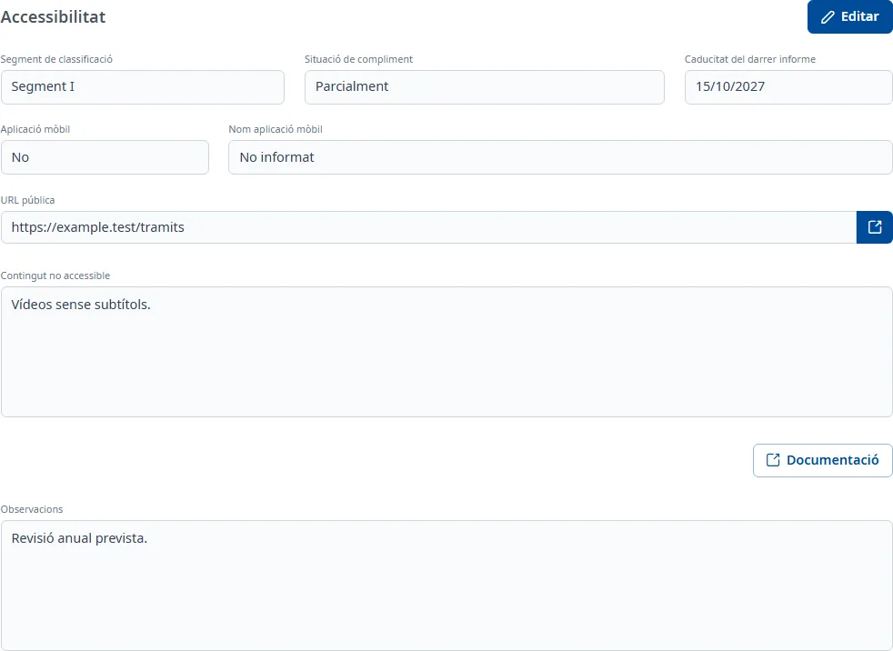

### Accessibilitat

#### Objectiu

Anotar la situació d'accessibilitat de l'aplicació: el segment de classificació, el compliment, la
caducitat del darrer informe, l'aplicació mòbil, la URL pública i el contingut no accessible.

#### Com s'hi accedeix

A la fitxa de l'aplicació, trieu la pestanya **Accessibilitat** (vegeu
[Com funciona la fitxa](overview.md)).

#### Accions disponibles

- **Editar**: posa la pestanya en edició.
- **Desar** i **Cancel·lar**, en edició.
- **Documentació**: encara no està implementada; només mostra un avís.
- La icona d'enllaç al costat de **URL pública** obre l'adreça en una pestanya nova, si és vàlida.

#### Formulari

En consulta, les dades buides diuen «No informat». En edició, tots els camps són opcionals:

- **Segment de classificació**: desplegable amb cerca.
- **Situació de compliment**: desplegable amb cerca.
- **Caducitat del darrer informe**: data, dd/mm/aaaa.
- **Aplicació mòbil**: **Sí** o **No**.
- **Nom aplicació mòbil**: només es pot escriure si **Aplicació mòbil** és **Sí**; si passa a **No**,
  el nom s'esborra. Com a màxim 255 caràcters.
- **URL pública**: ha de començar per `http://` o `https://`, amb un màxim de 255 caràcters.
- **Contingut no accessible**: text amb format.
- **Observacions**: text amb format.

Un **Segment de classificació** o una **Situació de compliment** ja desats no es poden tornar a
deixar en blanc: si els esborreu, tornen al valor desat i surt un avís. Sí que podeu triar un altre
valor.

#### Desar

Feu clic a **Desar**. Si una dada no és correcta, el missatge surt en vermell sota el camp, per
exemple «Introdueix una URL HTTP o HTTPS vàlida». Si tot és correcte, la pestanya torna a consulta i
surt l'avís **Canvis desats**. **Cancel·lar** desfà els canvis.

#### Condicions i permisos

- La pestanya només surt si el vostre usuari té permís per a l'àrea d'accessibilitat.
- En una aplicació donada de baixa no surt **Editar**.
- La pestanya surt com a incompleta («falten camps obligatoris») mentre faltin les dades que INVAI
  considera obligatòries.
- Si les dades o els catàlegs no es poden carregar, surt un avís amb un botó per tornar-los a
  carregar.
