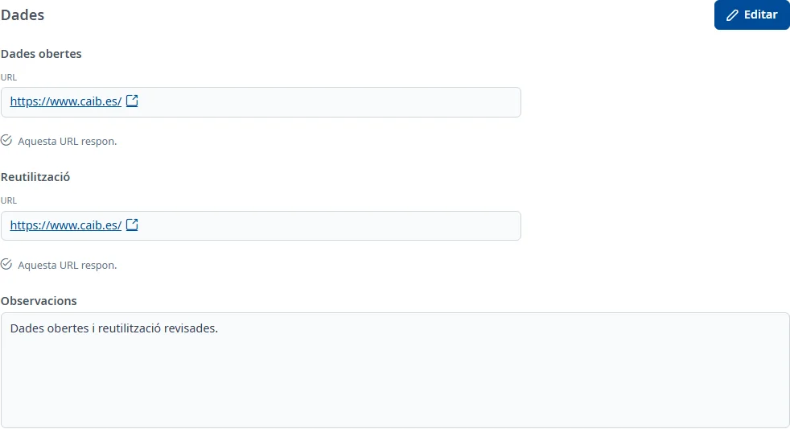

### Dades

#### Objectiu

Consultar els enllaços de dades obertes i de reutilització de l'aplicació, comprovar si responen i
anotar-hi observacions.

#### Com s'hi accedeix

A la fitxa de l'aplicació, trieu la pestanya **Dades** (vegeu
[Com funciona la fitxa](overview.md)).

#### Accions disponibles

- **Editar**: posa la pestanya en edició.
- **Desar**: guarda les observacions i les noves URL que hàgiu indicat.
- **Cancel·lar**: desfà els canvis encara no desats.
- L'enllaç **URL** de cada font obre l'adreça en una pestanya nova.
- **Torna a carregar les dades**: torna a provar de carregar una pestanya que ha fallat.

#### Formulari

##### Dades obertes i Reutilització

Cada font mostra la seva **URL** actual. Si no hi ha adreça, hi diu «No disponible»; si encara no
es coneix, «Es coneixerà quan es desin les dades de la pestanya.».

INVAI comprova cada adreça per separat. Mentre ho fa diu «Comprovant si aquesta URL respon…» i
després indica «Aquesta URL respon.», «Aquesta URL no respon.» o que no s'ha pogut comprovar.
Una adreça que no respon continua sent un enllaç que podeu obrir.

En edició, per a cada font:

- **Indicar la URL manualment**: opcional; marqueu-ho per substituir l'adreça actual.
- **Nova URL**: obligatòria només quan heu marcat la casella. Ha de començar per `http://` o
  `https://` en minúscules, sense espais dins de l'adreça, i tenir com a màxim 500 caràcters.

Podeu canviar una sola font. Si no marqueu la casella d'una font, se'n conserva l'adreça actual.
Quan torneu a editar, les caselles estan desmarcades i els camps de nova URL, buits: l'adreça desada
continua apareixent a **URL**.

##### Observacions

- **Observacions**: opcionals, amb text amb format. En consulta, si són buides, hi diu «No informat».

#### Desar

Feu clic a **Desar**. Si heu marcat una casella sense indicar la nova adreça, apareix «Indica la nova
URL o desmarca «Indicar la URL manualment».» sota el camp. Les adreces amb format incorrecte o massa
llargues també mostren el seu error.

En desar, es comprova si les noves adreces responen. Una URL amb format vàlid es desa encara que no
respongui: l'avís diu quina font heu de revisar. Si no hi ha aquest problema, surt **Canvis desats**.
La pestanya torna a consulta.

**Cancel·lar** recupera les observacions i les adreces que ja estaven desades. Els canvis de la
pestanya es guarden per separat dels de la resta de la fitxa.

#### Condicions i permisos

- La pestanya només surt si el vostre usuari té permís per a l'àrea de dades.
- En una aplicació donada de baixa no surt **Editar**.
- Si el registre de dades està donat de baixa, es pot consultar però no modificar.
- Si no es poden carregar les dades, feu servir **Torna a carregar les dades**. Una comprovació
  d'URL fallida no impedeix consultar l'altra font.
