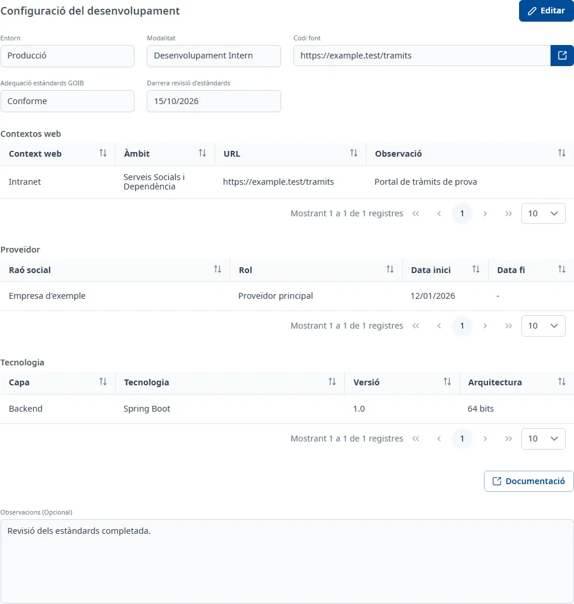

### Desenvolupament

#### Objectiu

Recollir com es desenvolupa l'aplicació: l'entorn, la modalitat, el codi font, l'adequació als
estàndards del Govern, i els contextos web, els proveïdors i les tecnologies que fa servir.

#### Com s'hi accedeix

A la fitxa de l'aplicació, trieu la pestanya **Desenvolupament** (vegeu
[Com funciona la fitxa](overview.md)). La pestanya es titula **Configuració del desenvolupament**.

#### Accions disponibles

- **Editar**: posa la pestanya en edició.
- **Desar** i **Cancel·lar**, en edició.
- La icona d'enllaç al costat de **Codi font** obre el repositori en una pestanya nova, si l'adreça
  és vàlida.
- **Documentació**: encara no està implementada; només mostra un avís.
- El botó **+** de **Contextos web**, **Proveïdor** i **Tecnologia**, en edició: afegeix un registre.
- Els tres punts de cada fila, en edició: **Consulta**, **Edita** i **Dona de baixa**.

En consulta, cada registre s'obre amb doble clic o amb <kbd>Intro</kbd> a la fila.

#### Taula de resultats

##### Contextos web

- **Context web**: els verificats a la pestanya [Seguretat](security.md) porten el text «Verificat».
- **Àmbit**
- **URL**
- **Observació**

##### Proveïdor

- **Raó social**
- **Rol**
- **Data inici**
- **Data fi**

##### Tecnologia

- **Capa**
- **Tecnologia**
- **Versió**
- **Arquitectura**

#### Formulari

##### Dades del desenvolupament

Obligatoris:

- **Entorn**: desplegable amb cerca.
- **Modalitat**
- **Codi font**: l'adreça del repositori; ha de començar per `http://` o `https://`, sense espais i
  amb un màxim de 1000 caràcters.
- **Adequació estàndards GOIB**
- **Darrera revisió d'estàndards**: data, dd/mm/aaaa.

Opcionals:

- **Observacions (Opcional)**: text amb format.

##### Afegir o editar un proveïdor

Obligatoris:

- **Raó social**: com a màxim 255 caràcters.
- **Rol**

Opcionals:

- **Data inici**
- **Data fi**: no pot ser anterior a la d'inici.

##### Afegir o editar una tecnologia

Obligatoris:

- **Tecnologia**: la **Capa** s'omple sola i no es pot modificar aquí.
- **Versió**: com a màxim 255 caràcters.
- **Arquitectura**: com a màxim 255 caràcters.

##### Afegir o editar un context web

Obligatoris:

- **Context web**
- **Àmbit**

Opcionals:

- **URL**: ha de començar per `http://` o `https://`, amb un màxim de 255 caràcters.
- **Observacions**

Un context web nou queda pendent de verificar a la pestanya [Seguretat](security.md).

##### Donar de baixa un registre

Trieu **Dona de baixa** al menú de la fila i confirmeu-ho.

#### Desar

**Desar** guarda les dades del desenvolupament. Si en falta alguna, surt «Camp obligatori» sota el
camp; si tot és correcte, la pestanya torna a consulta i surt l'avís **Canvis desats**.
**Cancel·lar** desfà aquests canvis.

Els contextos web, els proveïdors i les tecnologies es desen en confirmar cada finestra:
**Cancel·lar** no els desfà. Si tanqueu una finestra d'edició amb canvis sense desar, us demana si els
voleu **Descartar** o **Desar**.

#### Condicions i permisos

- La pestanya només surt si el vostre usuari té permís per a l'àrea de desenvolupament.
- En una aplicació donada de baixa no surt **Editar**; els registres es poden consultar igualment.
- Per gestionar els contextos web cal que l'aplicació tingui les fitxes de Desenvolupament i de
  Seguretat; si no, surt un avís que demana desar-ne primer les dades generals.
- La pestanya surt com a incompleta («falten camps obligatoris») mentre falti alguna dada obligatòria.
