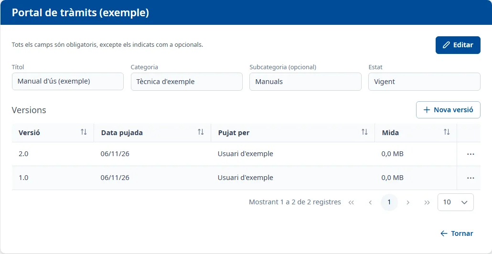

### Detall d'un document

#### Objectiu

Consultar o modificar les dades d'un document i conservar-ne les versions, amb el seu fitxer,
la data de pujada i l'usuari que el va pujar.

#### Com s'hi accedeix

A **Adjunts**, dins de [Documentació](documentation.md), feu doble clic o premeu <kbd>Intro</kbd>
a la fila, o trieu **Consulta** al menú de tres punts. S'obre una pantalla amb el nom de l'aplicació
a la capçalera, les dades del document i la taula **Versions**.

#### Accions disponibles

- **Editar**: permet canviar el títol, la classificació i l'estat del document.
- **Desar**: guarda aquests canvis.
- **Cancel·lar**: recupera les dades desades i torna a consulta.
- **Nova versió**: obre una finestra per afegir un fitxer nou al mateix document.
- Els tres punts de cada versió: **Descarregar** baixa aquell fitxer i **Veure** l'obre en una
  pestanya nova.
- **Tornar**: torna a la pestanya **Documentació** de l'aplicació.
- **Torna-ho a provar**: torna a carregar un document que no s'ha pogut obrir.

Una versió també s'obre amb doble clic o amb <kbd>Intro</kbd> a la seva fila.

#### Taula de resultats

**Versions** mostra, inicialment, les pujades més recents primer:

- **Versió**
- **Data pujada**
- **Pujat per**
- **Mida**: mida del fitxer en MB.

Podeu ordenar per aquestes columnes i passar de pàgina. Cada versió conserva el seu propi fitxer;
afegir-ne una altra no esborra les anteriors.

#### Formulari

##### Editar les dades del document

Obligatoris:

- **Títol**: com a màxim 150 caràcters.
- **Categoria**
- **Estat**: **Vigent**, **En revisió** o **Obsolet**.

Opcionals:

- **Subcategoria (opcional)**: d'entre les de la categoria triada. Canviar la categoria esborra la
  subcategoria anterior. Si el document ja pertany a una categoria o subcategoria donada de baixa,
  el valor actual es conserva a la llista d'opcions.

##### Afegir una versió

Obligatoris:

- **Versió**: com a màxim 20 caràcters; no pot repetir una etiqueta que ja tingui el document.
- **Fitxer**: com a màxim 5 MB i en un dels formats admesos pel selector.

Feu clic a **Desa** per afegir-la o a **Cancel·la** per tancar la finestra.

#### Desar

**Desar** a la capçalera guarda les dades del document i mostra **Document desat**. Si falta un camp
obligatori o el títol és massa llarg, el missatge surt sota el camp.

La finestra **Nova versió** es desa per separat i mostra **Versió afegida**. La versió nova passa a
ser la vigent de la llista d'adjunts. Si l'etiqueta es repeteix, surt «Ja existeix aquesta versió.».
Un fitxer massa gran o amb un format no admès es rebutja amb un avís abans de desar.

Si intenteu sortir amb canvis sense desar, l'avís **Canvis sense desar** ofereix **Continua editant**
o **Descarta els canvis**. **Cancel·lar** les dades del document no desfà una versió ja afegida.

#### Condicions i permisos

- Només podeu consultar els documents que el vostre usuari té permís per llegir.
- En una aplicació donada de baixa, o si el document està eliminat, la pantalla indica que és de
  només lectura: podeu consultar-ne i obrir-ne les versions, però no editar ni afegir-ne.
- Per afegir una versió cal que els formats admesos s'hagin carregat. Si no es poden carregar, el
  selector de fitxers queda indisponible amb el seu avís.
