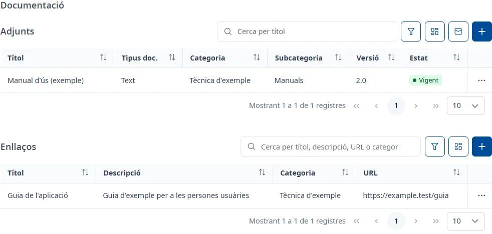
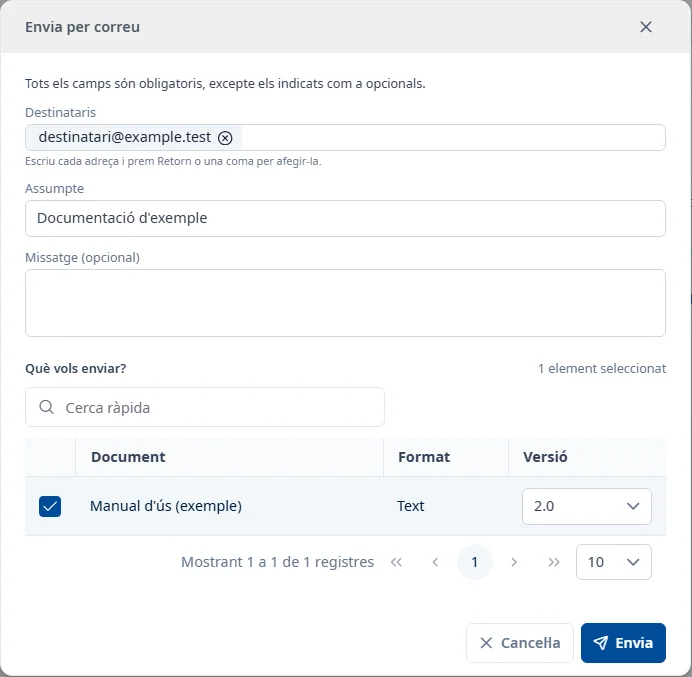

### Documentació

#### Objectiu

Consultar els fitxers i els enllaços de l'aplicació, classificar-los i enviar versions dels adjunts
per correu.

#### Com s'hi accedeix

A la fitxa de l'aplicació, trieu la pestanya **Documentació** (vegeu
[Com funciona la fitxa](overview.md)). Hi ha dues llistes independents: **Adjunts** i **Enllaços**.

#### Accions disponibles

##### Adjunts

- El botó **+**, **Afegeix un adjunt**: obre el formulari per carregar un fitxer.
- La icona del sobre, **Envia adjunts per correu**: obre **Envia per correu**.
- El botó de filtres, **Filtres dels adjunts**: mostra o amaga el cercador.
- **Columnes dels adjunts**: tria les columnes visibles.
- Els tres punts de la fila: **Consulta** obre [Detall d'un document](document-detail.md),
  **Descarrega** baixa el fitxer de la versió vigent i **Elimina** demana confirmació per eliminar
  el document. **Descarrega** només surt si el document té una versió vigent.

El document també s'obre amb doble clic o amb <kbd>Intro</kbd> a la fila.

##### Enllaços

- El botó **+**, **Afegeix un enllaç**: obre el formulari d'alta.
- **Filtres dels enllaços**: mostra o amaga el cercador.
- **Columnes dels enllaços**: tria les columnes visibles.
- Els tres punts de la fila: **Consulta** obre les dades de l'enllaç i **Elimina** demana
  confirmació per eliminar-lo.
- La **URL** obre la web en una pestanya nova.

En consulta de l'enllaç, **Editar** permet modificar-lo. La consulta també s'obre amb doble clic o
amb <kbd>Intro</kbd> a la fila.

#### Cerca i filtres

La cerca i la paginació d'una llista no modifiquen les de l'altra. Feu servir **Cerca** per aplicar
els filtres i **Neteja** per esborrar-los.

##### Adjunts

- Cerca ràpida: pel **Títol** del document.
- **Tipus de document**: el format del fitxer, com ara PDF o Word.
- **Categoria**
- **Subcategoria**: s'habilita quan trieu una categoria i només ofereix les seves subcategories.
- **Estat**: **Vigent**, **En revisió** o **Obsolet**.

Canviar la categoria esborra la subcategoria seleccionada.

##### Enllaços

- Cerca ràpida: pel títol, la descripció, la URL o la categoria.
- **Categoria**

#### Taula de resultats

##### Adjunts

- **Títol**
- **Tipus doc.**: format de la versió vigent.
- **Categoria**
- **Subcategoria**
- **Versió**: etiqueta de la versió vigent.
- **Estat**: estat documental, amb el seu text.

##### Enllaços

- **Títol**
- **Descripció**
- **Categoria**
- **URL**

Podeu ordenar les columnes que tenen control d'ordenació, canviar les visibles i passar de pàgina.

#### Formulari

##### Afegir un adjunt

Obligatoris:

- **Títol**: com a màxim 150 caràcters.
- **Fitxer**: trieu-lo amb **Adjunta** o arrossegueu-lo a la zona de càrrega. Com a màxim 5 MB,
  en un dels formats admesos que mostra el selector. **Elimina el fitxer seleccionat** permet
  canviar-lo abans de desar. **Tipus de document** s'omple a partir del fitxer.
- **Categoria**
- **Versió**: etiqueta de fins a 20 caràcters, per exemple «1.0».

Opcionals:

- **Subcategoria (opcional)**: d'entre les de la categoria triada.

El document nou es crea en estat **Vigent**. Per canviar-ne l'estat o afegir versions, obriu
[Detall d'un document](document-detail.md).

##### Afegir o editar un enllaç

Obligatoris:

- **Títol**: com a màxim 250 caràcters.
- **Categoria**
- **URL**: ha de començar per `http://` o `https://` en minúscules, sense espais, amb un màxim de
  500 caràcters.

Opcionals:

- **Descripció (opcional)**: com a màxim 1000 caràcters.

##### Enviar adjunts per correu

Obligatoris:

- **Destinataris**: almenys una adreça vàlida i com a màxim 20. Escriviu una adreça i premeu
  <kbd>Intro</kbd>, una coma o un punt i coma per afegir-la. Les adreces repetides compten una sola
  vegada; cada adreça pot tenir com a màxim 320 caràcters.
- **Assumpte**: com a màxim 250 caràcters, sense salts de línia. Inicialment inclou el codi de
  l'aplicació i el podeu canviar.
- A **Què vols enviar?**, seleccioneu almenys un document amb fitxer. La taula mostra **Selecció**,
  **Document**, **Format** i **Versió**. El total de fitxers seleccionats no pot superar els 15 MB.

Opcionals:

- **Missatge (opcional)**: com a màxim 4000 caràcters.

La cerca ràpida d'aquesta finestra busca pel títol. Podeu seleccionar documents de diverses pàgines:
la selecció es conserva en cercar i paginar. Inicialment s'envia la versió vigent; al costat de cada
document seleccionat podeu triar-ne una altra. Si no es poden carregar les versions, un avís indica
que s'enviarà la vigent. Els enllaços no es poden seleccionar com a adjunts.

**Envia** tramet el correu i mostra **Correu enviat** quan acaba. **Cancel·la** tanca la finestra.
Si l'enviament falla, la finestra es manté oberta amb les dades per poder-ho tornar a provar.

#### Desar

Cada alta, modificació o eliminació es confirma a la seva finestra i s'aplica immediatament.
**Documentació** no té un botó de desar conjunt. En afegir un adjunt o desar un enllaç, la llista
corresponent s'actualitza i apareix l'avís de l'operació.

Les eliminacions necessiten confirmació. Tancar o canviar de pestanya no desfà una operació ja
confirmada.

#### Condicions i permisos

- Tothom pot obrir la pestanya, però només es mostren els documents de les categories que el vostre
  usuari pot consultar. També cal tenir permís per als documents que envieu per correu.
- En una aplicació donada de baixa es pot consultar i descarregar; els botons d'alta i eliminació
  no surten.
- Per adjuntar fitxers cal que s'hagin carregat els formats admesos. Si fallen, el selector avisa
  que no es pot adjuntar cap fitxer.
- Si no hi ha resultats, la llista indica «No hi ha cap adjunt.» o «No hi ha cap enllaç.».
