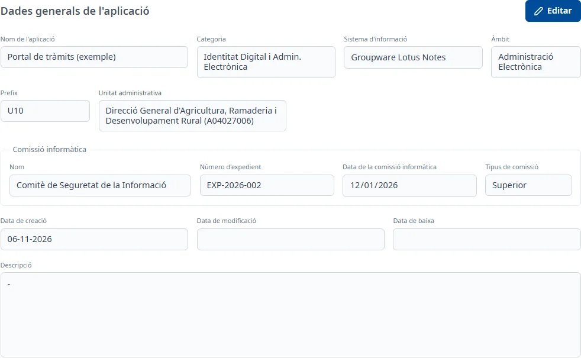

### General

#### Objectiu

Consultar i modificar les dades generals de l'aplicació (nom, classificació, unitat administrativa
i comissió informàtica), i donar-la de baixa o tornar-la a donar d'alta.

#### Com s'hi accedeix

És la primera pestanya de la fitxa i la que s'obre en entrar a una aplicació (vegeu
[Com funciona la fitxa](overview.md)).

#### Accions disponibles

- **Editar**: posa la pestanya en edició.
- **Desar** i **Cancel·lar**, en edició: guarden o desfan els canvis.
- **Donar de baixa**, en edició: dona de baixa l'aplicació (vegeu més avall).
- **Restaurar**, en una aplicació donada de baixa: la torna a donar d'alta.

#### Formulari

Les dades surten sota **Dades generals de l'aplicació**. En consulta es veuen com a text; en
edició, com a camps.

Obligatoris:

- **Nom de l'aplicació**
- **Categoria**
- **Sistema d'informació**
- **Àmbit**
- **Prefix**: com a màxim 3 caràcters.
- **Unitat administrativa**: obriu el desplegable i escriviu part del nom o del codi de la unitat.
  Si hi ha més de 20 resultats, només se'n mostren els 20 primers: concreteu la cerca.
- **Nom** de la **Comissió informàtica**: en triar-la, s'omplen sols el **Número d'expedient**, la
  **Data de la comissió informàtica** i el **Tipus de comissió**.

Opcionals:

- **Descripció**: admet text amb format.

No es poden modificar mai la **Data de creació**, la **Data de modificació** ni la **Data de
baixa**, ni les dades de la comissió que s'omplen soles.

#### Desar

Feu clic a **Desar**. Si falta algun camp obligatori, surt «Camp obligatori» sota el camp. Si tot és
correcte, la pestanya torna a consulta i surt l'avís **Canvis desats**.

Si heu canviat el prefix, a l'aplicació se li assignen els rols de Soffid del prefix nou, i l'avís
diu quants se n'han assignat. Si no s'han pogut assignar, surt «Els canvis s'han desat, però no
s'han pogut assignar els rols de Soffid del prefix…».

##### Donar de baixa

1. Feu clic a **Editar** i després a **Donar de baixa**, a sota de les dades.
2. Confirmeu-ho a la finestra **Donar de baixa l'aplicació?** amb **Donar de baixa**, o feu-vos
   enrere amb **Cancel·la**.

Surt l'avís **Aplicació donada de baixa** i torneu a la llista, on l'aplicació ja no surt mentre el
filtre **Estat** mostri només les actives.

##### Restaurar

Una aplicació donada de baixa mostra «L'aplicació està donada de baixa» i el botó **Restaurar**.
Feu-hi clic i confirmeu-ho a la finestra **Donar d'alta l'aplicació?** amb **Donar d'alta**. Surt
l'avís **Aplicació donada d'alta**, que diu també quants rols de Soffid se li han assignat.

#### Condicions i permisos

- Tothom pot obrir la pestanya **General**.
- **Editar** i **Donar de baixa** no surten en una aplicació donada de baixa; només **Restaurar**.
- Si teniu canvis sense desar en altres pestanyes, abans de donar de baixa l'aplicació us demanarà
  que els deseu o els cancel·leu.
