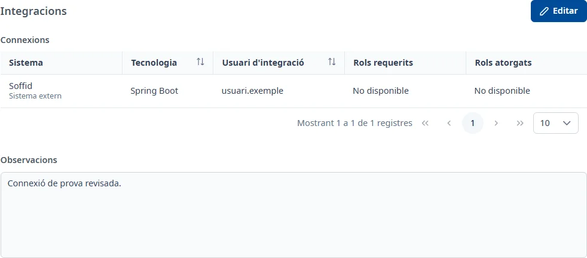

### Integracions

#### Objectiu

Consultar i gestionar les connexions de l'aplicació amb altres aplicacions de l'inventari o
sistemes externs, amb l'usuari d'integració, la tecnologia i els rols de Soffid que requereixen.

#### Com s'hi accedeix

A la fitxa de l'aplicació, trieu la pestanya **Integracions** (vegeu
[Com funciona la fitxa](overview.md)).

#### Accions disponibles

- **Editar**: posa la pestanya en edició.
- **Desar**: guarda les observacions de la pestanya.
- **Cancel·lar**: recupera les observacions desades.
- El botó **+**, **Afegeix una connexió**, en edició: obre **Afegir connexió**.
- Els tres punts de cada fila, en edició: **Consulta**, **Edita** i **Dona de baixa**.
- **Torna a carregar les integracions**: torna a provar de carregar les dades de la pestanya.

En consulta, feu doble clic o premeu <kbd>Intro</kbd> a la fila per obrir **Consultar connexió**.

#### Taula de resultats

- **Sistema**: l'aplicació de l'inventari o el sistema extern de la connexió.
- **Tecnologia**: la tecnologia amb què es fa la connexió.
- **Usuari d'integració**: el codi d'usuari de Soffid.
- **Rols requerits**: els rols indicats per a aquesta connexió.
- **Rols atorgats**: els rols que Soffid retorna per a l'usuari.

Podeu ordenar les columnes que mostren el control d'ordenació i passar de pàgina. La finestra de
consulta mostra també **Coincidència de rols**: «Coincideixen», «No coincideixen» o «No s'ha pogut
comprovar».

Una icona d'exclamació al costat del sistema avisa que els rols requerits no coincideixen amb els
atorgats. Passeu-hi el ratolí o arribeu-hi amb <kbd>Tab</kbd> per llegir-ne el missatge.

Si no s'han pogut consultar els rols a Soffid, la consulta ho avisa i la connexió no es pot editar
fins que torneu a carregar la pestanya.

#### Formulari

##### Afegir o editar una connexió

Tots els camps són obligatoris:

- **Tipus de sistema**: **Aplicació de l'inventari** o **Sistema extern**.
- **Aplicació**, si heu triat una aplicació de l'inventari: obriu la llista i cerqueu-la per nom o
  codi. Cal triar un resultat.
- **Sistema extern**, si heu triat aquest tipus: seleccioneu-lo al desplegable.
- **Tecnologia**: desplegable amb cerca.
- **Usuari d'integració**: cerqueu-lo a Soffid i seleccioneu una persona de la llista que tingui codi
  d'usuari. Escriure un nom sense seleccionar-lo no és suficient.
- **Rols requerits**: obriu la llista, cerqueu pel nom del rol i seleccioneu-ne almenys un. Podeu
  triar-ne diversos.

Canviar el **Tipus de sistema** esborra la selecció del tipus anterior. Els rols atorgats es
consulten a Soffid; no s'editen en aquest formulari.

##### Donar de baixa una connexió

Trieu **Dona de baixa** i confirmeu-ho. La connexió deixa d'aparèixer a la taula de connexions
actives.

##### Observacions

- **Observacions**: opcionals, amb text amb format.

#### Desar

Les connexions es desen en confirmar la seva finestra i es donen de baixa en confirmar l'avís.
Aquestes operacions són immediates: **Cancel·lar** la pestanya no les desfà.

**Desar** a la capçalera guarda només les **Observacions** i mostra **Canvis desats**. Si tanqueu
una finestra d'edició de connexió amb canvis, podeu **Descartar** o **Desar** aquests canvis.

#### Condicions i permisos

- La pestanya només surt si el vostre usuari té permís per a l'àrea d'integracions.
- En una aplicació donada de baixa no surt **Editar**; les connexions es poden consultar.
- Si INVAI demana desar les observacions abans d'afegir connexions, feu-ho per habilitar-ne l'alta.
- Si no es carreguen els desplegables de tecnologia o sistemes externs, tanqueu el formulari i
  torneu-lo a obrir.
- La pestanya surt com a incompleta mentre no hi hagi cap connexió activa.
