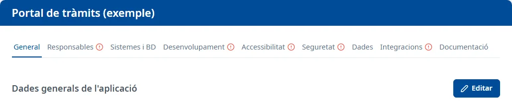

### Com funciona la fitxa

#### Objectiu

Consultar i completar totes les dades d'una aplicació, repartides en pestanyes.

#### Com s'hi accedeix

A la [Llista d'aplicacions](../applications/list.md), feu doble clic a la fila de l'aplicació,
situeu-vos-hi i premeu <kbd>Intro</kbd>, o trieu **Consulta** o **Edita** al menú de la fila. La
fitxa s'obre a la pestanya **General**, amb el nom de l'aplicació com a títol. La ruta de navegació
mostra **Aplicacions** i el codi de l'aplicació; feu clic a **Aplicacions** per tornar a la llista.

#### Pestanyes

- [General](general.md)
- [Responsables](responsible.md)
- [Sistemes i BD](systems-databases.md)
- [Desenvolupament](development.md)
- [Accessibilitat](accessibility.md)
- [Seguretat](security.md)
- [Dades](data.md)
- [Integracions](integrations.md)
- [Documentació](documentation.md)

Una icona d'exclamació al costat del nom d'una pestanya indica que hi falten dades. En passar-hi el
ratolí, o en arribar-hi amb <kbd>Tab</kbd>, en veureu el motiu, per exemple «La secció Sistemes i BD
està incompleta: no hi ha cap sistema actiu.». Si els indicadors no es poden actualitzar, surt un
avís amb el botó **Torna a carregar els indicadors**.

#### Consultar i editar

Cada pestanya s'obre en consulta i es desa per separat:

- **Editar** posa la pestanya en edició.
- **Desar** guarda els canvis de la pestanya. Surt l'avís **Canvis desats**.
- **Cancel·lar** desfà els canvis de la pestanya.

Podeu canviar de pestanya sense perdre el que heu editat. Si voleu sortir de l'aplicació amb canvis
sense desar, l'avís **Canvis sense desar** diu quines pestanyes heu de desar o cancel·lar abans;
**Entesos** el tanca. Si tanqueu o recarregueu la pestanya del navegador amb canvis, el navegador
també us avisa.

#### Condicions i permisos

- **General** i **Documentació** les pot obrir tothom. Les altres pestanyes només surten si el vostre
  usuari té permís per a aquella àrea; si n'obriu l'adreça sense permís, s'obre **General**.
- En una aplicació donada de baixa, cap pestanya mostra **Editar**. Per tornar-la a donar d'alta,
  vegeu [General](general.md).
