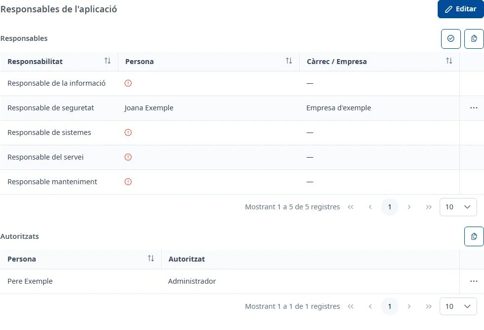

### Responsables

#### Objectiu

Assignar les persones responsables de l'aplicació, una per a cada tipus de responsabilitat, i les
persones autoritzades, i comprovar que el seu DIR3 coincideix amb el de l'aplicació.

#### Com s'hi accedeix

A la fitxa de l'aplicació, trieu la pestanya **Responsables** (vegeu
[Com funciona la fitxa](overview.md)).

#### Accions disponibles

Al panell **Responsables**:

- **Validar el DIR3 de l'aplicació** (el botó de verificació): comprova el DIR3 de tots els
  responsables i autoritzats amb el de l'aplicació.
- **Copia la taula de responsables** (el botó de copiar): copia la pàgina visible de la taula al
  porta-retalls, per enganxar-la, per exemple, en un full de càlcul.
- **Afegeix un responsable** (el botó **+**), en edició.

Al panell **Autoritzats**:

- **Copia la taula de persones autoritzades**.
- **Afegeix una persona autoritzada** (el botó **+**), en edició.

Els tres punts de cada fila obren el menú del registre:

- **Consulta**: mostra totes les dades de la persona en una finestra. També s'obre amb doble clic o
  amb <kbd>Intro</kbd> a la fila.
- **Editar** i **Donar de baixa**, en edició.
- **Confirmar discrepància DIR3**, en edició, per a un responsable de personal CAIB amb el DIR3
  pendent de validar.

#### Taula de resultats

La taula **Responsables** té una fila per a cada tipus de responsabilitat:

- **Responsabilitat**
- **Persona**: el nom i, per al personal CAIB, el codi d'usuari a sota. Una icona taronja vol dir
  «DIR3 no validat»; una de verda, «DIR3 validat manualment», amb el motiu.
- **Càrrec / Empresa**: el càrrec del personal CAIB o l'empresa de les persones externes.

Una responsabilitat sense ningú assignat mostra a **Persona** una icona vermella; en passar-hi el
ratolí, diu «Incomplet».

La taula **Autoritzats** té les columnes **Persona** i **Autoritzat**, amb els tipus d'autorització
de cada persona.

#### Formulari

##### Afegir o editar un responsable

1. A **Personal CAIB**, activeu l'interruptor si la persona és personal de la CAIB. Algunes
   responsabilitats l'exigeixen: aleshores l'interruptor queda activat i surt «Aquesta
   responsabilitat requereix personal CAIB.».
2. Trieu la **Responsabilitat**. Només surten les que encara no tenen ningú assignat.
3. Trieu la persona:
   - Personal CAIB: a **Persona CAIB**, escriviu almenys 3 caràcters del nom, del codi d'usuari o del
     correu i trieu la persona de la llista de Soffid. Si voleu, escriviu-ne el **Càrrec**.
   - Persona externa: trieu l'**Empresa** i després la **Persona**, entre les persones externes
     d'aquesta empresa.
4. L'**E-mail** s'omple sol. Si voleu, escriviu unes **Observacions (Opcional)**.
5. Feu clic a **Afegir**.

En triar una persona CAIB, INVAI comprova el seu DIR3 («Comprovant DIR3…»). Si no coincideix amb el
de l'aplicació, surt «El DIR3 de la persona no coincideix amb el de l'aplicació.» i l'apartat
**Validar manualment**: si marqueu la casella i escriviu el **Motiu**, la discrepància queda
validada; si no, el responsable es desa amb el DIR3 pendent de validar.

Si totes les responsabilitats ja estan assignades, **Afegeix un responsable** mostra «Totes les
responsabilitats estan assignades»: primer n'heu de donar de baixa una. En editar un responsable
només es poden canviar el **Càrrec** i les **Observacions**.

##### Afegir o editar una persona autoritzada

Els camps són els mateixos que per a un responsable, sense **Responsabilitat** ni **Càrrec**, i amb
**Autoritzat**, obligatori: trieu-hi un o més tipus d'autorització. En editar-la només es poden
canviar **Autoritzat** i les **Observacions**.

##### Donar de baixa

Trieu **Donar de baixa** al menú de la fila. A la finestra **Donar de baixa aquest registre?**,
escriviu unes **Observacions**, obligatòries, i feu clic a **Donar de baixa**. La responsabilitat
queda sense ningú assignat i es pot tornar a assignar.

##### Confirmar discrepància DIR3

Trieu **Confirmar discrepància DIR3** al menú de la fila. La finestra torna a comprovar el DIR3 i
mostra el resultat. Si encara no coincideix, marqueu la casella, escriviu el **Motiu** i feu clic a
**Confirmar**: la icona de la persona passa a «DIR3 validat manualment».

#### Desar

Cada finestra es desa en confirmar-la (**Afegir**, **Desar**, **Donar de baixa** o **Confirmar**), i
surt un avís com «El responsable s'ha afegit correctament.». Els botons **Desar** i **Cancel·lar** de
la pestanya només tanquen l'edició: **Cancel·lar** no desfà el que ja s'ha desat a les finestres.

Si tanqueu una finestra amb canvis sense desar, us demana si els voleu **Descartar** o **Desar**.

#### Condicions i permisos

- La pestanya només surt si el vostre usuari té permís per consultar els responsables.
- Si el vostre usuari no els pot modificar, en confirmar una finestra surt «No tens permisos per fer
  aquesta operació.».
- En una aplicació donada de baixa no surten **Editar**, **Validar el DIR3 de l'aplicació** ni els
  botons per afegir; el menú de les files només té **Consulta**.
- La pestanya surt com a incompleta mentre falti assignar algun tipus de responsabilitat, no hi hagi
  cap persona autoritzada o hi hagi responsables de personal CAIB amb el DIR3 pendent de validar.
