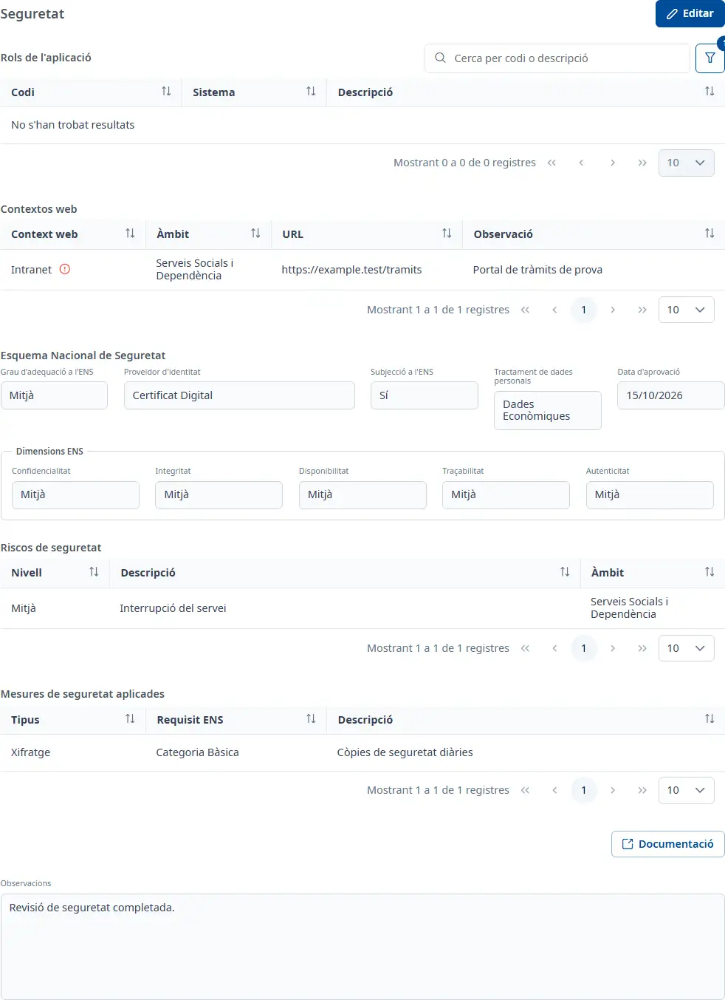

### Seguretat

#### Objectiu

Recollir la seguretat de l'aplicació: els seus rols de Soffid, els contextos web, la classificació
segons l'Esquema Nacional de Seguretat (ENS), els riscos i les mesures aplicades.

#### Com s'hi accedeix

A la fitxa de l'aplicació, trieu la pestanya **Seguretat** (vegeu
[Com funciona la fitxa](overview.md)).

#### Accions disponibles

- **Editar**: posa la pestanya en edició.
- **Desar** i **Cancel·lar**, en edició.
- **Documentació**: encara no està disponible; només mostra un avís.
- El botó **+** de **Rols de l'aplicació**, **Riscos de seguretat** i **Mesures de seguretat
  aplicades**, en edició: afegeix un registre.
- Els tres punts de cada fila, en edició: **Consulta**, **Edita** i **Dona de baixa**, i
  **Validar manualment** per a un rol no validat.
- **Verificar**, en edició, a cada context web pendent de verificar.

En consulta, la finestra **Consulta** de cada registre s'obre amb doble clic o amb <kbd>Intro</kbd> a
la fila.

#### Cerca i filtres

La taula **Rols de l'aplicació** té una cerca ràpida per codi o descripció i un **Cercador** amb
**Codi** i **Sistema**. Per defecte només mostra els rols del sistema **weblogic**; **Neteja** hi
torna.

#### Taula de resultats

##### Rols de l'aplicació

- **Codi**: una icona verda indica validació manual; una de taronja, que el rol no està validat
  perquè el codi no comença pel prefix de l'aplicació. El missatge de la icona n'explica l'estat.
- **Sistema**
- **Descripció**

##### Contextos web

- **Context web**: una icona verda indica que està verificat; una d'avís vermella, que està pendent.
  El missatge de la icona n'explica l'estat; en els verificats mostra el motiu de la verificació.
- **Àmbit**
- **URL**
- **Observació**

Els contextos web s'afegeixen a [Desenvolupament](development.md); aquí només es consulten i es
verifiquen.

##### Riscos de seguretat

- **Nivell**
- **Descripció**
- **Àmbit**

##### Mesures de seguretat aplicades

- **Tipus**
- **Requisit ENS**
- **Descripció**

#### Formulari

##### Esquema Nacional de Seguretat

Tots els camps són opcionals:

- **Grau d'adequació a l'ENS**
- **Proveïdor d'identitat**
- **Subjecció a l'ENS**
- **Tractament de dades personals**
- **Data d'aprovació**: data, dd/mm/aaaa.

Dins de **Dimensions ENS**, també opcionals:

- **Confidencialitat**
- **Integritat**
- **Disponibilitat**
- **Traçabilitat**
- **Autenticitat**

Si el servidor té més d'una classificació ENS activa, surt «Dades ENS inconsistents» i aquests camps
no es poden editar fins que es corregeixin les dades.

A sota, **Observacions** admet text amb format.

##### Afegir un rol

A **Codi**, obriu la llista i escriviu el codi del rol, per exemple amb el prefix de l'aplicació, i
trieu-lo entre els rols de Soffid. **Sistema** i **Descripció** s'omplen sols. Si el codi no comença
pel prefix de l'aplicació, el rol es desa com a validat manualment al vostre nom.

##### Afegir o editar un risc

Tots els camps són opcionals:

- **Nivell**
- **Àmbit**
- **Descripció**

##### Afegir o editar una mesura

Tots els camps són opcionals:

- **Tipus**
- **Requisit ENS**
- **Descripció**

##### Verificar un context web

Feu clic a **Verificar** a la fila, escriviu el **Motiu de la verificació**, obligatori, i feu clic a
**Verificar**. La icona passa a verda.

##### Donar de baixa un registre

Trieu **Dona de baixa** al menú de la fila i confirmeu-ho. El registre deixa de sortir a la taula.

#### Desar

**Desar** guarda la classificació ENS i les **Observacions**, i surt l'avís **Canvis desats**.
**Cancel·lar** les desfà. Els rols, els riscos, les mesures i les verificacions es desen en
confirmar cada finestra: **Cancel·lar** no els desfà.

#### Condicions i permisos

- La pestanya només surt si el vostre usuari té permís per a l'àrea de seguretat, que inclou
  assignar els rols de Soffid.
- En una aplicació donada de baixa no surt **Editar**; els registres es poden consultar igualment.
- Si els botons **+** de riscos i mesures surten desactivats, l'aplicació encara no té la fitxa de
  seguretat: deseu primer les dades generals de Seguretat.
- La pestanya surt com a incompleta mentre falti almenys un context web, una classificació ENS o un
  risc actiu, i avisa si hi ha contextos web pendents de verificar.
