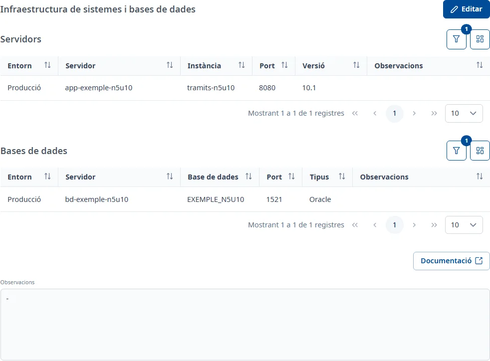

### Sistemes i BD

#### Objectiu

Relacionar l'aplicació amb els servidors i les bases de dades on funciona, i anotar-hi observacions.

#### Com s'hi accedeix

A la fitxa de l'aplicació, trieu la pestanya **Sistemes i BD** (vegeu
[Com funciona la fitxa](overview.md)). La pestanya es titula **Infraestructura de sistemes i bases
de dades**.

#### Accions disponibles

- **Editar**: posa la pestanya en edició.
- **Desar** i **Cancel·lar**, en edició.
- **Documentació**, a sota: encara no està implementada; només mostra un avís.

Als panells **Servidors** i **Bases de dades**:

- **Filtres** (el botó de l'embut): obre i tanca el **Cercador** del panell.
- **Mostra / oculta columnes**: tria les columnes de la taula.
- **Afegeix** (el botó **+**), en edició: relaciona un servidor o una base de dades.

En edició, els tres punts de cada fila obren el menú del registre, amb **Consulta** i **Elimina**.
En consulta, la finestra **Consultar** s'obre amb doble clic o amb <kbd>Intro</kbd> a la fila.

#### Cerca i filtres

Els dos panells tenen el **Cercador** plegat; per defecte mostren només les relacions actives.

- **Servidors**: **Entorn**, **Servidor**, **Instància**, **Port**, **Versió**, **Estat** i
  **Observacions**.
- **Bases de dades**: **Entorn**, **Servidor**, **Versió**, **Base de dades**, **Servei**, **Port**,
  **Tipus**, **Estat** i **Observacions**.

De moment només s'apliquen **Servidor** o **Base de dades** i **Estat**. Si ompliu un altre filtre,
surt «El filtre «…» encara no està suportat pel servidor i no s'aplicarà.». **Cerca** aplica els
filtres i **Neteja** els torna a l'estat **Actiu**.

#### Taula de resultats

**Servidors**:

- **Entorn**
- **Servidor**
- **Instància**
- **Port**
- **Versió**
- **Observacions**

**Bases de dades**:

- **Entorn**
- **Servidor**
- **Base de dades**
- **Port**
- **Tipus**
- **Observacions**

La columna **Estat** («Actiu» o «Inactiu») només surt quan buideu el filtre **Estat**. Totes les
columnes es poden ordenar.

#### Formulari

##### Relacionar un servidor o una base de dades

1. Feu clic a **Editar** i després al botó **+** del panell.
2. A la finestra **Afegir servidor a l'aplicació** (o **Afegir base de dades a l'aplicació**), cerqueu
   el registre amb la cerca ràpida o amb el **Cercador**. Només surten els servidors o les bases de
   dades actius que encara no estan relacionats amb l'aplicació.
3. Seleccioneu-ne un fent clic a la fila o amb <kbd>Intro</kbd>.
4. Feu clic a **Afegir**.

Surt l'avís «El servidor s'ha afegit correctament a l'aplicació.» (o «La base de dades…»). No hi ha
cap altre camp per omplir: les dades del servidor o de la base de dades es mantenen a
**Manteniments**.

##### Eliminar una relació

En edició, trieu **Elimina** al menú de la fila i confirmeu-ho amb **Dona de baixa**. La relació
queda inactiva i deixa de sortir a la llista mentre el filtre **Estat** mostri només les actives.

##### Observacions

A sota dels panells, **Observacions** admet text amb format. En edició es poden escriure; si el text
és massa llarg, surt «El text supera la mida màxima permesa…».

#### Desar

**Desar** guarda les **Observacions** i surt l'avís **Canvis desats**. Les relacions es desen en el
moment d'afegir-les o eliminar-les: **Cancel·lar** només desfà els canvis de les **Observacions**.

#### Condicions i permisos

- La pestanya només surt si el vostre usuari té permís per a l'àrea de sistemes.
- En una aplicació donada de baixa no surt **Editar**; les files es poden consultar igualment.
- Si el botó **+** surt desactivat en edició, l'aplicació encara no té la fitxa de sistemes i bases
  de dades: escriviu les **Observacions**, feu clic a **Desar** i torneu a fer clic a **Editar**.
- La pestanya surt com a incompleta mentre no hi hagi cap servidor o cap base de dades actius.
