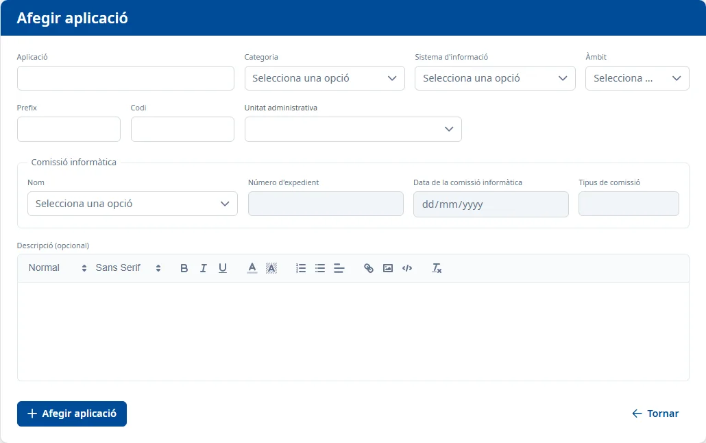

### Alta d'una aplicació

#### Objectiu

Afegir una aplicació nova a l'inventari amb les dades bàsiques. La resta de la fitxa (responsables,
sistemes, desenvolupament…) es completa després des de la fitxa de l'aplicació.

#### Com s'hi accedeix

A la [Llista d'aplicacions](list.md), feu clic al botó **+** de la barra d'eines.

#### Accions disponibles

- **Afegir aplicació**: dona d'alta l'aplicació (vegeu [Desar](#desar)).
- **Tornar**: torna a la llista sense desar res.

#### Formulari

Obligatoris:

- **Aplicació**: el nom de l'aplicació.
- **Categoria**
- **Sistema d'informació**
- **Àmbit**
- **Prefix**: com a màxim 3 caràcters.
- **Codi**: entre 4 i 10 caràcters.
- **Unitat administrativa**: obriu el desplegable i escriviu part del nom o del codi de la unitat.
  Si hi ha més de 20 resultats, només se'n mostren els 20 primers: concreteu la cerca.
- **Nom** de la **Comissió informàtica**: en triar-la, s'omplen sols el **Número d'expedient**, la
  **Data de la comissió informàtica** i el **Tipus de comissió**, que surten en gris i no es poden
  escriure.

Opcionals:

- **Descripció (opcional)**

#### Desar

Feu clic a **Afegir aplicació** o premeu <kbd>Intro</kbd> en un camp de text.

- Si falta algun camp obligatori, surt «Camp obligatori» sota el camp. Si el prefix o el codi no
  tenen la llargada correcta, el missatge ho diu («El prefix ha de tenir com a màxim 3 caràcters»,
  «El codi ha de tenir com a mínim 4 caràcters»).
- Si tot és correcte, torneu a la llista amb l'avís **Aplicació afegida**, que diu quants rols de
  Soffid s'han assignat a l'aplicació (per exemple «Aplicació afegida correctament amb 1 rol de
  Soffid assignat.»), o que no n'hi ha cap amb el seu prefix.
- Si l'aplicació s'ha afegit però els rols no s'han pogut assignar, surt «L'aplicació s'ha afegit,
  però no s'han pogut assignar els seus rols de Soffid.».
- Si no s'ha pogut afegir, surt «No s'ha pogut afegir l'aplicació.».

#### Condicions i permisos

- El prefix no pot ser el d'una altra aplicació: si ho és, l'alta no es fa i un missatge us ho
  indica.
- En donar d'alta l'aplicació se li assignen els rols de Soffid que tenen el seu prefix.
