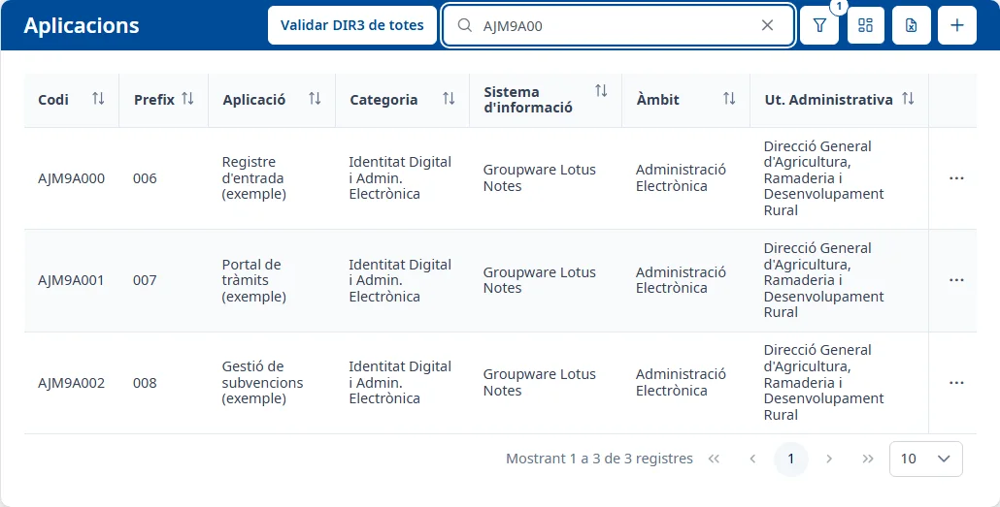
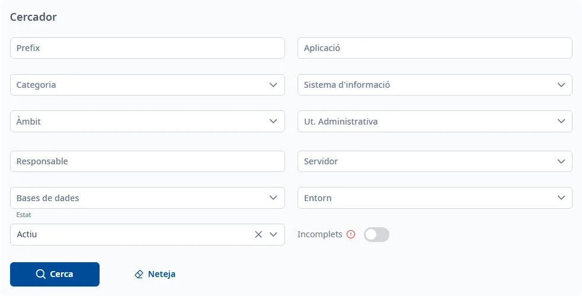
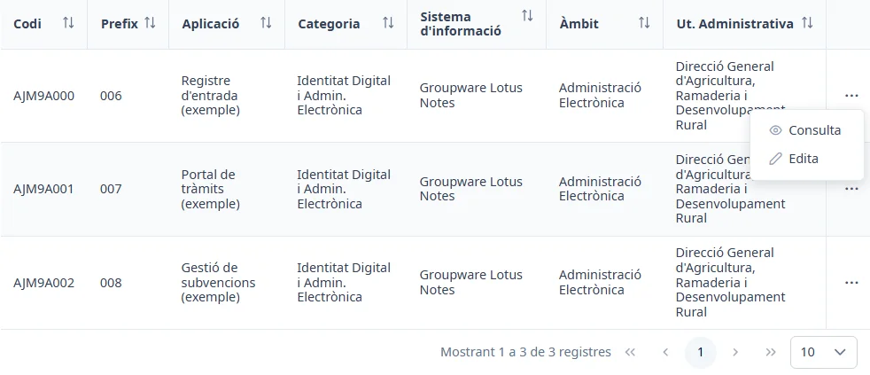

### Llista d'aplicacions

#### Objectiu

Consultar les aplicacions de l'inventari, trobar-ne una, obrir-ne la fitxa o donar-ne d'alta una de
nova.

#### Com s'hi accedeix

Al menú lateral, trieu **Aplicacions**. També és la pàgina que s'obre en entrar a INVAI i en fer clic
als logotips de la capçalera.

#### Accions disponibles

- **Validar DIR3 de totes**: comprova la unitat administrativa de cada aplicació activa amb el
  directori DIR3 (vegeu més avall).
- **Cerca ràpida**: busca mentre escriviu.
- **Filtres** (el botó de l'embut): obre i tanca el **Cercador**.
- **Mostra / oculta columnes**: tria les columnes de la taula.
- **Exporta excel (.xls)**: encara no està implementat; només mostra un avís.
- **Afegeix** (el botó **+**): obre l'[Alta d'una aplicació](create.md).

##### Validar DIR3 de totes

Feu clic a **Validar DIR3 de totes** per comprovar amb el directori DIR3 la unitat administrativa de
totes les aplicacions actives. Mentre dura, el botó mostra quantes en porta («Validant DIR3: 12 de
40»). En acabar, l'avís **Validació DIR3 completada** diu quantes aplicacions tenen discrepàncies
i, si n'hi ha, quantes no s'han pogut validar.

#### Cerca i filtres

La **Cerca ràpida** busca mentre escriviu, sense prémer <kbd>Intro</kbd>, i torna a la primera
pàgina. La creu del quadre l'esborra.

El botó de l'embut obre el **Cercador**, amb aquests filtres:

- **Prefix**
- **Aplicació**
- **Categoria**
- **Sistema d'informació**
- **Àmbit**
- **Ut. Administrativa**: escriviu part del nom de la unitat per cercar-la.
- **Responsable**: escriviu part del nom i trieu la persona de la llista; el text escrit sense triar
  ningú no compta.
- **Servidor**
- **Bases de dades**
- **Entorn**
- **Estat**: **Actiu** per defecte, així que la llista mostra només les aplicacions actives.
- **Incomplets**: si l'activeu, mostra només les aplicacions que tenen alguna secció de la fitxa per
  completar.

**Cerca** aplica els filtres i **Neteja** els torna als valors inicials i torna a cercar. El número
sobre l'embut indica quants filtres es van aplicar a l'última cerca; per l'**Estat**, hi surt un
**1** des del principi. Més detalls a [Trucs de la interfície](../getting-started/interface-tips.md).

#### Taula de resultats

Columnes que es veuen per defecte:

- **Codi**
- **Prefix**
- **Aplicació**
- **Categoria**
- **Sistema d'informació**
- **Àmbit**
- **Ut. Administrativa**

Columnes amagades, que podeu mostrar amb **Mostra / oculta columnes**:

- **Comissió informàtica**
- **Estat**, que es mostra sola quan buideu el filtre **Estat**.

Totes les columnes es poden ordenar fent clic al títol. A sota de la taula es pot canviar de pàgina
i triar quantes files es veuen (10 per defecte).

Per obrir una aplicació, feu doble clic a la fila, o situeu-vos-hi amb <kbd>Tab</kbd> i premeu
<kbd>Intro</kbd>: s'obre la seva fitxa, a la pestanya **General**. Els tres punts del final de la
fila obren el menú de l'aplicació:

- **Consulta**: obre la fitxa per consultar-la.
- **Edita**: obre la pestanya **General** de la fitxa directament en edició.

#### Condicions i permisos

- **Edita** no està disponible per a les aplicacions inactives.
- **Validar DIR3 de totes** només comprova les aplicacions actives.
- Si la llista no es pot carregar, surt l'avís «No s'han pogut carregar les aplicacions.».
