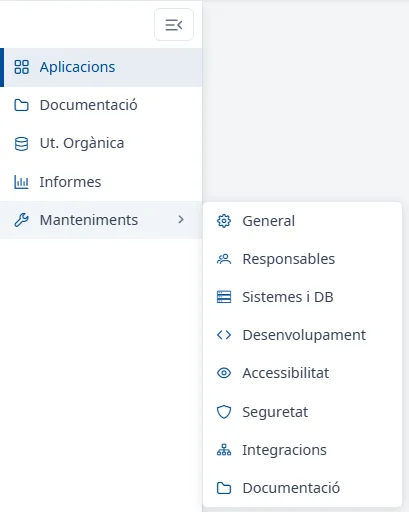
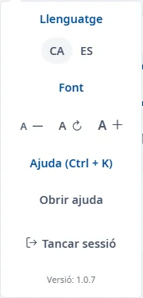

### Capçalera i menú d'usuari

#### Objectiu

Conèixer el que surt a totes les pàgines d'INVAI (la capçalera, el menú lateral i el peu) i les
opcions del menú d'usuari.

#### Com s'hi accedeix

La capçalera, el menú lateral i el peu són a totes les pàgines. El menú d'usuari s'obre fent clic al
vostre nom, a dalt a la dreta.

#### Capçalera

- **Logotips del Govern i d'INVAI**: tornen a l'inici, la
  [Llista d'aplicacions](../applications/list.md).
- **Campana de notificacions**: encara no mostra res.
- **El vostre nom i el vostre usuari**: obren el menú d'usuari.

Sota la capçalera, la ruta de navegació mostra on sou, començant per **Inici**. Feu clic en un dels
trams per tornar-hi. Mentre es carrega una pàgina, una barra fina a la part de baix de la capçalera
ho indica.

#### Menú lateral

- **Aplicacions**: la llista de les aplicacions de l'inventari.
- **Documentació**: encara no té contingut.
- **Ut. Orgànica** i **Informes**: encara no porten a cap pantalla.
- **Manteniments**: en passar-hi el ratolí o fer-hi clic, obre al costat un submenú amb les seccions
  de manteniment:
  - **General**
  - **Responsables**
  - **Sistemes i DB**
  - **Desenvolupament**
  - **Accessibilitat**
  - **Seguretat**
  - **Integracions**
  - **Documentació**

El botó de dalt del menú (**Tanca el menú**) el plega perquè només se'n vegin les icones; el mateix
botó (**Obre el menú**) el torna a desplegar. Amb el menú plegat, en passar el ratolí per una icona
en veureu el nom. Amb el teclat, les fletxes recorren el menú i <kbd>Intro</kbd> obre l'opció. En pantalles petites el menú lateral s'amaga: obriu-lo
amb el botó de les tres ratlles, a dalt a l'esquerra, i tanqueu-lo amb <kbd>Esc</kbd> o fent clic
fora.

#### Menú d'usuari

- **Llenguatge**: **CA** i **ES** canvien l'idioma de tota l'aplicació. INVAI es torna a carregar
  en l'idioma triat i obre la llista d'aplicacions. L'idioma actual surt marcat.
- **Font**: **A −** redueix la mida de la lletra, **A ↻** la torna a la mida normal i **A +**
  l'augmenta. Cada clic la canvia una mica.
- **Ajuda (Ctrl + K)**: **Obrir ajuda** obre aquest centre d'ajuda (vegeu
  [Com fer servir l'ajuda](using-help.md)).
- **Tancar sessió**: tanca la sessió d'INVAI i la del sistema d'identificació del Govern.
- **Versió**: la versió d'INVAI que feu servir.

Per tancar el menú sense triar res, premeu <kbd>Esc</kbd> o feu clic fora.

#### Peu de pàgina

Al final de cada pàgina hi ha **© Govern Illes Balears**, la versió d'INVAI i
**Declaració d'accessibilitat**, que obre la declaració d'accessibilitat d'INVAI en una finestra.

#### Coses a tenir en compte

- L'idioma i la mida de la lletra es guarden al navegador: es mantenen quan torneu a entrar des del
  mateix ordinador i el mateix navegador.
