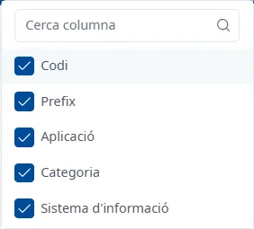

### Trucs de la interfície

#### Objectiu

Reunir les funcions que es repeteixen a totes les pantalles d'INVAI i ajuden a treballar més ràpid:
la cerca, els filtres i les columnes de les llistes, els formularis, els desplegables i les dreceres
de teclat.

#### Com s'hi accedeix

Aquests trucs serveixen a totes les llistes, fitxes i finestres d'INVAI. Cada pantalla té el seu tema
amb el detall dels seus camps i accions.

#### Barra de les llistes

- **Cerca ràpida**: busca mentre escriviu, sense prémer <kbd>Intro</kbd>, i torna a la primera
  pàgina. La creu del quadre l'esborra.
- **Filtres** (el botó de l'embut): obre i tanca el **Cercador**, a sota de la barra.
- **Mostra / oculta columnes**: tria les columnes que es veuen.
- **Exporta excel (.xls)**: només a la llista d'aplicacions; encara no està implementat i només
  mostra un avís.
- **Afegeix** (el botó **+**): obre l'alta d'un registre nou.

En passar el ratolí per aquests botons en veureu el nom.

#### Filtres

1. Feu clic al botó de l'embut per obrir el **Cercador**.
2. Ompliu els filtres que vulgueu i feu clic a **Cerca**. Prémer <kbd>Intro</kbd> en un filtre no
   cerca.
3. **Neteja** torna els filtres als valors inicials i torna a cercar.

El número que surt sobre l'embut indica quants filtres es van aplicar a l'última cerca. A la llista
d'aplicacions hi surt un **1** des del principi, perquè **Estat** mostra només les actives.

#### Columnes

Feu clic a **Mostra / oculta columnes** i marqueu les columnes que vulgueu veure. El quadre
**Cerca columna** les filtra pel nom. La tria no es guarda: quan torneu a entrar, la llista surt amb
les columnes de sempre.

#### Taules

- **Ordenar**: feu clic al títol d'una columna amb fletxes; un altre clic inverteix l'ordre. Només
  s'ordena per una columna alhora. Amb el teclat, arribeu al títol amb <kbd>Tab</kbd> i premeu
  <kbd>Intro</kbd> o <kbd>Espai</kbd>.
- **Obrir un registre**: feu doble clic a la fila, o situeu-vos-hi amb <kbd>Tab</kbd> i premeu
  <kbd>Intro</kbd>.
- **Accions d'un registre**: els tres punts del final de la fila obren el menú del registre, per
  exemple **Consulta** i **Edita**.
- **Pàgines**: a sota de la taula, quants registres es mostren (per exemple «Mostrant 1 a 10 de 25
  registres»), els botons per canviar de pàgina i quantes files es veuen per pàgina: 10, 20, 50
  o 100. Per defecte, 10.

Si una cerca no troba res, la taula diu «No s'han trobat resultats».

#### Formularis

- Els camps opcionals porten «(opcional)» al nom; tots els altres són obligatoris. Algunes finestres
  ho recorden amb «Tots els camps són obligatoris, excepte els indicats com a opcionals.».
- Si un camp obligatori queda buit o té un valor incorrecte, el missatge surt en vermell a sota del
  camp quan en sortiu, i tots alhora quan intenteu desar.
- A la fitxa d'una aplicació, cada pestanya s'obre en consulta. **Editar** la posa en edició,
  **Desar** guarda els canvis de la pestanya i **Cancel·lar** els desfà. En desar, surt l'avís
  «Canvis desats».
- Podeu canviar de pestanya sense perdre el que heu editat. Si voleu sortir de l'aplicació amb
  canvis sense desar, l'avís **Canvis sense desar** diu quines pestanyes heu de desar o cancel·lar
  abans; **Entesos** el tanca.
- Si tanqueu una finestra de manteniment amb canvis sense desar, us demana si els voleu
  **Descartar** o **Desar**.

#### Desplegables i dates

- Els desplegables amb molts valors tenen un quadre per cercar-hi: escriviu-hi part del nom. Als
  filtres, la creu del desplegable el buida.
- Les dates s'escriuen com dd/mm/aaaa o es trien al calendari, que comença la setmana en dilluns.

#### Avisos

- Els avisos de confirmació («Canvis desats», «Aplicació donada de baixa»…) surten a dalt a la dreta
  i desapareixen sols al cap de pocs segons; la creu els tanca abans.
- Els errors que torna el servidor surten en una finestra amb el botó **Tanca**.

#### Dreceres de teclat

- <kbd>Ctrl</kbd> + <kbd>K</kbd> (<kbd>Cmd</kbd> + <kbd>K</kbd> en un Mac): obre i tanca l'ajuda des
  de qualsevol lloc. Vegeu [Com fer servir l'ajuda](using-help.md).
- <kbd>Esc</kbd>: tanca el desplegable o la finestra oberta, primer el desplegable.
- <kbd>Intro</kbd>: obre la fila de la taula on sou, o ordena per la columna on sou.
- <kbd>Tab</kbd> i <kbd>Maj</kbd> + <kbd>Tab</kbd>: passen al control següent o a l'anterior.
- Fletxes: recorren les opcions dels desplegables, dels menús de les files i del menú lateral.
