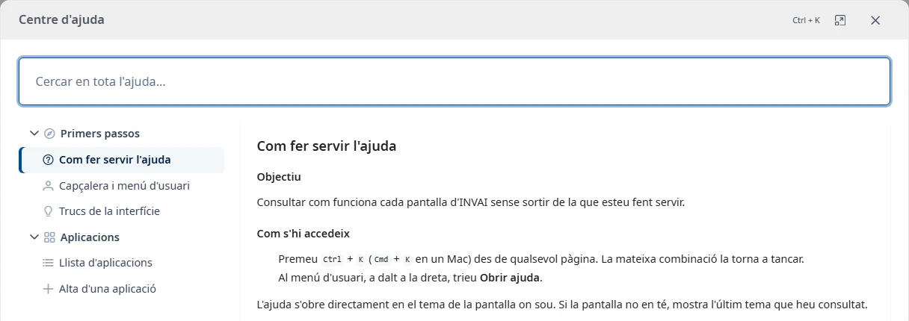
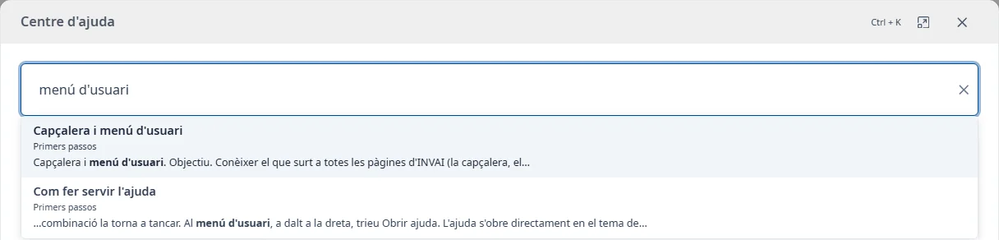

### Com fer servir l'ajuda

#### Objectiu

Consultar com funciona cada pantalla d'INVAI sense sortir de la que esteu fent servir.

#### Com s'hi accedeix

- Premeu <kbd>Ctrl</kbd> + <kbd>K</kbd> (<kbd>Cmd</kbd> + <kbd>K</kbd> en un Mac) des de qualsevol
  pàgina. La mateixa combinació la torna a tancar.
- Al menú d'usuari, a dalt a la dreta, trieu **Obrir ajuda**.
- A les pantalles i finestres amb ajuda disponible, premeu el botó **Obrir ajuda** (icona
  d'interrogació) de la capçalera. Obre el tema de la pantalla, la pestanya o el formulari.

L'ajuda s'obre directament en el tema de la pantalla on sou. Si la pantalla no en té, mostra l'últim
tema que heu consultat.

#### Cercar

El cercador de dalt (**Cercar en tota l'ajuda...**) busca en el text de tots els temes, no només en
els títols, a partir de dues lletres:

- No distingeix majúscules ni accents: «aplicacio» troba «Aplicació».
- Amb diverses paraules, mostra els temes que les tenen totes, encara que no estiguin juntes.
- Primer surten els temes que tenen les paraules al títol i després els que les repeteixen més.

Cada resultat mostra el títol del tema, l'àrea on és i un fragment amb la paraula en negreta.
Premeu <kbd>Intro</kbd> per obrir el primer, o trieu-ne un altre amb les fletxes o el ratolí. La
primera vegada que premeu <kbd>Esc</kbd> es tanquen els resultats; la segona, l'ajuda.

#### Índex

A l'esquerra (a dalt en pantalles petites) hi ha tots els temes, agrupats per àrees. El tema obert hi
surt marcat.

La llista de temes i el contingut es desplacen per separat. El cercador es manté visible a dalt.

- Feu clic en un tema per obrir-lo.
- Cada vegada que obriu l'ajuda, només es desplega la branca del tema actiu. Feu clic al nom
  d'una àrea per desplegar-la o plegar-la.
- Amb el teclat, <kbd>Tab</kbd> recorre la llista i <kbd>Intro</kbd> o <kbd>Espai</kbd> obren el
  tema o pleguen l'àrea.

Quan obriu un tema, el focus va al seu títol, i <kbd>Tab</kbd> continua dins del tema.

#### Enllaços

Els enllaços a altres temes els obren dins del mateix centre d'ajuda. Els enllaços a altres webs
s'obren en una pestanya nova.

#### Mida de la finestra

El botó de maximitzar, al costat del de tancar, fa que l'ajuda ocupi tota la pantalla. Torneu-hi a
fer clic per recuperar la mida anterior.

#### Coses a tenir en compte

- Per tancar l'ajuda, premeu <kbd>Esc</kbd>, feu clic al botó de tancar o fora de la finestra, o
  premeu una altra vegada <kbd>Ctrl</kbd> + <kbd>K</kbd>. Tornareu al lloc on éreu.
- Si l'ajuda no es pot carregar, veureu un avís amb el botó **Reintentar**.
- La resta d'opcions del menú d'usuari són a
  [Capçalera i menú d'usuari](header-and-user-menu.md).
