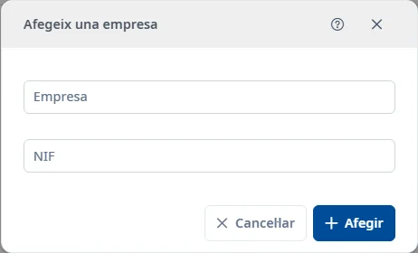

### Empreses

#### Objectiu

Consultar i mantenir els registres de **Empreses**.

#### Com s'hi accedeix

**Manteniments** → **Responsables** → **Empreses**. [Com funciona Responsables](responsibles.md).

#### Accions disponibles

- El botó **+** obre l’alta.
- L’embut mostra o amaga els filtres.
- El selector de columnes canvia les columnes visibles.
- La creu del cercador ràpid neteja el text.
- El menú de tres punts de cada fila permet consultar, editar o donar de baixa. La baixa demana confirmació.
- Doble clic o <kbd>Intro</kbd> sobre una fila obre la consulta.
- El botó d’ajuda del formulari i <kbd>Ctrl</kbd> + <kbd>K</kbd> obren aquest tema.

#### Cerca i filtres

La cerca ràpida filtra la llista. Per combinar criteris, desplegau l’embut:

- **NIF**
- **Empresa**
- **Estat**

**Cerca** aplica els filtres; **Neteja** els restableix. L’estat inicial és **Actiu**. També hi ha l’opció **Inactiu**.

#### Taula de resultats

- **NIF**
- **Empresa**
- **Estat**

L’estat s’oculta a la consulta d’actius. Utilitzau les capçaleres ordenables i els controls de paginació per recórrer els resultats.

#### Formulari

##### Afegir o editar

Obligatoris:

- **Empresa**: màxim 150 caràcters.

Opcionals:

- **NIF**: màxim 20 caràcters.

#### Desar

**Afegir** crea el registre i **Desar** aplica els canvis. Corregiu els camps marcats si hi ha errors. **Cancel·lar** abandona l’operació. En tancar una edició modificada, podeu desar o descartar els canvis.

#### Condicions i permisos

Les operacions poden ser rebutjades si no teniu els permisos necessaris. En un registre inactiu podeu utilitzar la restauració. Donar de baixa una empresa també dona de baixa les seves persones i les assignacions que tenen a aplicacions. Llegiu la confirmació abans de continuar.
