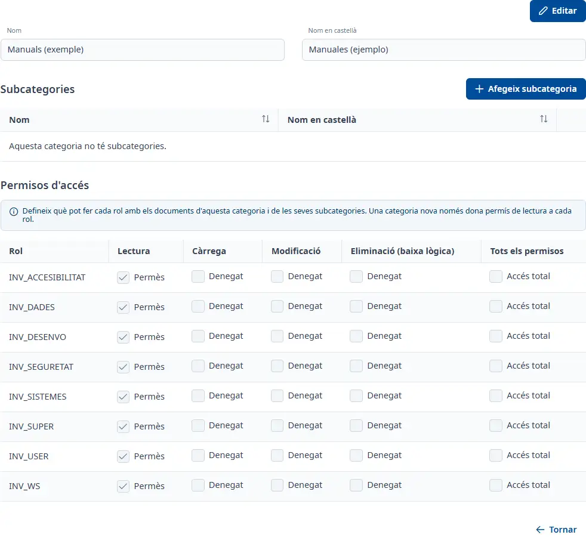

### Detall d’una categoria documental

#### Objectiu

Consultar i editar una categoria documental, les seves subcategories i els permisos d’accés dels rols.

#### Com s'hi accedeix

**Manteniments** → **Documentació** → **Categories documentals**. Obriu una fila amb doble clic, <kbd>Intro</kbd> o la consulta del menú. Vegeu [Documentació](documentation.md).

#### Accions disponibles

- **Editar**
- **Cancel·lar**
- **Afegeix subcategoria**
- **Desa**
- **Tornar**

L’edició activa els noms i els permisos. Cancel·lar recupera els valors desats. Tornar retorna a la llista; si hi ha canvis sense desar, podeu continuar editant o sortir descartant-los.

#### Taula de resultats

**Subcategories**:

- **Nom**
- **Nom en castellà**

El menú de cada fila permet consultar, editar, donar de baixa o restaurar segons l’estat. Les subcategories es desen amb el seu propi formulari.

**Permisos d'accés**:

- **Rol**
- **Lectura**
- **Càrrega**
- **Modificació**
- **Eliminació (baixa lògica)**
- **Tots els permisos**

Cada fila correspon a un rol. La darrera casella activa o desactiva tots els permisos de la fila. Els permisos s’apliquen als documents de la categoria i de les seves subcategories. Una categoria nova només concedeix lectura a cada rol.

#### Formulari

##### Editar la categoria o una subcategoria

Obligatoris:

- **Nom**
- **Nom en castellà**

Tots dos noms admeten fins a 150 caràcters. En crear una subcategoria, la categoria queda fixada a la fitxa actual. En editar-la, podeu triar una altra categoria activa per moure-la.

#### Desar

Premeu **Desa** per desar els noms i permisos de la categoria. Els canvis de subcategories es confirmen al seu formulari i refresquen la taula.

#### Condicions i permisos

Una categoria inactiva només es pot consultar: restaurau-la des de la llista abans de modificar-la. Els permisos només es consulten i modifiquen en categories actives.
