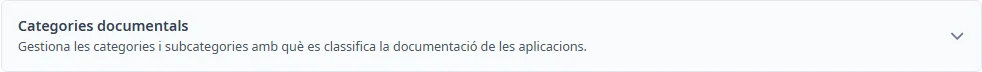
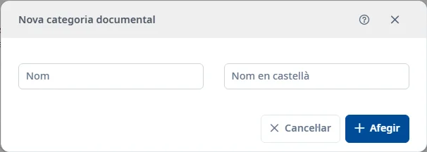

### Documentació

#### Objectiu

Organitzar les categories i subcategories amb què es classifiquen els documents. Des de la fitxa de cada categoria podeu gestionar els permisos d’accés dels rols.

#### Com s'hi accedeix

Obriu **Manteniments** → **Documentació**. Premeu el títol d’un apartat per desplegar-lo; amb el teclat, utilitzau <kbd>Tab</kbd> i <kbd>Intro</kbd>.

#### Accions disponibles

- **+** obre l’alta del catàleg desplegat.
- L’embut mostra o amaga els filtres.
- El selector de columnes permet triar les columnes visibles.
- La creu de la cerca ràpida neteja el text.
- El menú de tres punts d’una fila permet consultar, editar o donar de baixa; la baixa demana confirmació.
- Doble clic o <kbd>Intro</kbd> sobre una fila obre la consulta.
- En un registre inactiu, la restauració permet recuperar-lo.
- El botó d’ajuda del formulari i <kbd>Ctrl</kbd> + <kbd>K</kbd> obren aquest tema.

La consulta i l’edició obren la fitxa de la categoria: [Detall d’una categoria documental](document-category.md).

#### Cerca i filtres

La cerca ràpida filtra els registres. Per combinar criteris, obriu l’embut i premeu **Cerca**. **Neteja** restableix els filtres. **Estat** parteix d’**Actiu**; podeu seleccionar **Inactiu** o netejar-lo per consultar tots els estats.

##### Categories documentals

- **Nom**
- **Estat**

#### Taula de resultats

La fletxa al costat d’una categoria desplega les seves subcategories. La cerca per text desplega els resultats relacionats. Les subcategories també tenen menú propi amb **Consulta**, **Edita**, **Elimina** i **Restaura**, segons l’estat.

Les capçaleres ordenables canvien l’ordre; els controls de paginació permeten recórrer la llista. Les columnes disponibles són:

##### Categories documentals

- **Nom**
- **Nom en castellà**
- **Subcategories actives**

#### Formulari

En consulta, les dades es poden llegir. Per modificar-les, activau **Editar**.

##### Categories documentals

Obligatoris:

- **Nom**: màxim 150 caràcters.
- **Nom en castellà**: màxim 150 caràcters.

#### Desar

**Afegir** crea el registre; **Desar** desa una edició. Corregiu els camps assenyalats si hi ha errors. En consulta, **Acceptar** tanca el formulari. **Cancel·lar** abandona l’alta o recupera la consulta en cancel·lar una edició. Si tancau una edició modificada, podeu desar o descartar els canvis.

#### Condicions i permisos

Les operacions depenen dels permisos de la sessió i de l’estat del registre. Les opcions dels desplegables provenen dels catàlegs; si falta una opció necessària, revisau el seu manteniment. Un error en desar no confirma l’operació: revisau el missatge i torneu-ho a provar quan s’hagi resolt.
