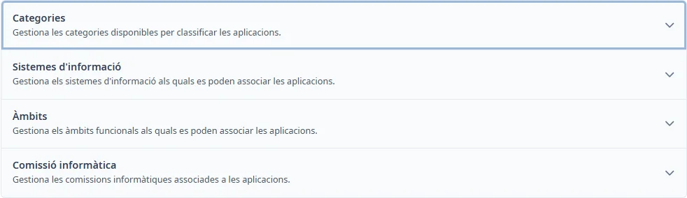

### Com funciona General

#### Objectiu

Gestionar els catàlegs compartits que s’utilitzen a les aplicacions.

#### Com s'hi accedeix

Obriu **Manteniments** → **General**.

#### Apartats

- [Categories](categories.md)
- [Sistemes d'informació](system-types.md)
- [Àmbits](fields.md)
- [Comissió informàtica](commissions.md)

#### Accions disponibles

Premeu el títol d’un apartat per desplegar-lo o plegar-lo. Amb el teclat, arribeu al títol amb <kbd>Tab</kbd> i activeu-lo amb <kbd>Intro</kbd> o <kbd>Espai</kbd>.

Des d’aquesta pantalla, <kbd>Ctrl</kbd> + <kbd>K</kbd> obre aquest tema. Dins un formulari de catàleg, obre l’ajuda del catàleg.
