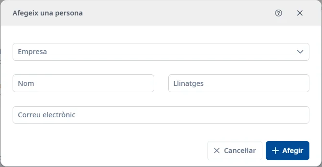

### Personal extern

#### Objectiu

Consultar i mantenir els registres de **Personal extern**.

#### Com s'hi accedeix

**Manteniments** → **Responsables** → **Personal extern**. [Com funciona Responsables](responsibles.md).

#### Accions disponibles

- El botó **+** obre l’alta.
- L’embut mostra o amaga els filtres.
- El selector de columnes canvia les columnes visibles.
- La creu del cercador ràpid neteja el text.
- El menú de tres punts de cada fila permet consultar, editar o donar de baixa. La baixa demana confirmació.
- Doble clic o <kbd>Intro</kbd> sobre una fila obre la consulta.
- El botó d’ajuda del formulari i <kbd>Ctrl</kbd> + <kbd>K</kbd> obren aquest tema.

#### Cerca i filtres

La cerca ràpida filtra la llista. Per combinar criteris, desplegau l’embut:

- **Empresa**
- **Nom**
- **Llinatges**
- **Correu electrònic**
- **Origen**
- **Estat**

**Cerca** aplica els filtres; **Neteja** els restableix. L’estat inicial és **Actiu**. També hi ha l’opció **Inactiu**.

**Origen**: **Persones externes** / **Personal CAIB**.

#### Taula de resultats

- **Empresa**
- **Nom**
- **Llinatges**
- **Correu electrònic**
- **Estat**

L’estat s’oculta a la consulta d’actius. Utilitzau les capçaleres ordenables i els controls de paginació per recórrer els resultats.

#### Formulari

##### Afegir o editar

Obligatoris:

- **Empresa**.
- **Nom**: màxim 150 caràcters.
- **Llinatges**: màxim 150 caràcters.
- **Correu electrònic**: màxim 150 caràcters.

Triau una empresa activa i introduïu una adreça electrònica vàlida.

#### Desar

**Afegir** crea el registre i **Desar** aplica els canvis. Corregiu els camps marcats si hi ha errors. **Cancel·lar** abandona l’operació. En tancar una edició modificada, podeu desar o descartar els canvis.

#### Condicions i permisos

Les operacions poden ser rebutjades si no teniu els permisos necessaris. En un registre inactiu podeu utilitzar la restauració. Cal permís de modificació de responsables. Sense empreses actives no es pot afegir una persona. El personal CAIB és de consulta. Una persona amb empresa inactiva no es pot restaurar. Abans de donar de baixa es comproven les assignacions; si n’hi ha, podeu transferir-les des de la confirmació. [Transferència i revocació de rols](role-transfer.md).
