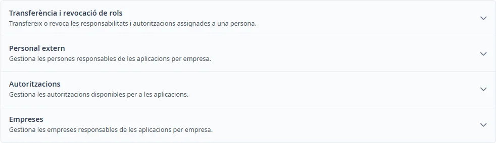

### Com funciona Responsables

#### Objectiu

Gestionar els catàlegs compartits que s’utilitzen a les aplicacions.

#### Com s'hi accedeix

Obriu **Manteniments** → **Responsables**.

#### Apartats

- [Transferència i revocació de rols](role-transfer.md)
- [Personal extern](people.md)
- [Autoritzacions](authorizations.md)
- [Empreses](companies.md)

#### Accions disponibles

Premeu el títol d’un apartat per desplegar-lo o plegar-lo. Amb el teclat, arribeu al títol amb <kbd>Tab</kbd> i activeu-lo amb <kbd>Intro</kbd> o <kbd>Espai</kbd>.

Des d’aquesta pantalla, <kbd>Ctrl</kbd> + <kbd>K</kbd> obre aquest tema. Dins un formulari de catàleg, obre l’ajuda del catàleg.

#### Condicions i permisos

La transferència i revocació requereix el perfil INV_SUPER. Personal extern només apareix amb permís de modificació de responsables. Autoritzacions i Empreses es poden consultar des d’aquesta pantalla.
