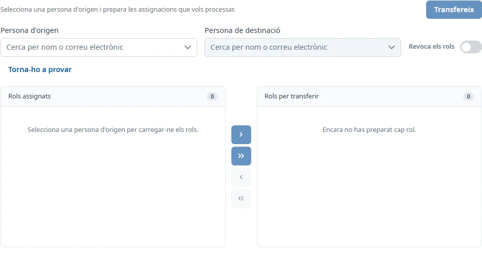

### Transferència i revocació de rols

#### Objectiu

Transferir responsabilitats i autoritzacions entre persones, o revocar les assignacions seleccionades.

#### Com s'hi accedeix

**Manteniments** → **Responsables** → **Transferència i revocació de rols**. [Com funciona Responsables](responsibles.md).

#### Accions disponibles

Les fletxes permeten moure els rols seleccionats o tots els rols al lot i retornar-los a l’origen. També podeu moure una aplicació sencera o un grup de responsabilitats o autoritzacions. Preparar el lot encara no modifica les assignacions.

#### Cerca i filtres

Escriviu almenys tres caràcters als cercadors de persones o obriu el desplegable per veure els primers resultats. Seleccioneu una opció: escriure el nom no és suficient. L’origen ha de ser una persona ja registrada; la destinació també pot procedir del directori corporatiu.

#### Formulari

##### Preparar una transferència

Obligatoris:

- **Persona d'origen**
- **Persona de destinació**

Seleccioneu les assignacions de la llista d’origen i moveu-les al lot. La destinació ha de ser diferent de l’origen. Espereu que es carreguin les seves assignacions.

##### Preparar una revocació

Activeu **Revoca els rols**. Només cal l’origen i un lot amb assignacions; no cal destinació.

#### Desar

Premeu **Transfereix** o **Revoca**. Reviseu el nombre de rols i les persones a la confirmació abans d’acceptar. La revocació dona de baixa les assignacions i esborra les seves observacions. Si canviau o netejau l’origen amb un lot preparat, es demana confirmar que es descarta el lot.

#### Condicions i permisos

Si la destinació ja té una autorització a una aplicació, no podeu moure-hi una altra autorització d’aquella aplicació. Les assignacions incompatibles que ja eren al lot tornen a l’origen quan es carrega la destinació.

Requereix INV_SUPER. El botó final només s’activa amb un origen vàlid, un lot no buit i, per transferir, una destinació vàlida amb les dades carregades. Si falla una càrrega, utilitzau el botó per tornar-ho a provar abans de continuar.
