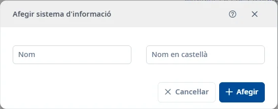

### Sistemes d'informació

#### Objectiu

Consultar i mantenir els registres de **Sistemes d'informació**.

#### Com s'hi accedeix

**Manteniments** → **General** → **Sistemes d'informació**. [Com funciona General](general.md).

#### Accions disponibles

- El botó **+** obre l’alta.
- L’embut mostra o amaga els filtres.
- El selector de columnes canvia les columnes visibles.
- La creu del cercador ràpid neteja el text.
- El menú de tres punts de cada fila permet consultar, editar o donar de baixa. La baixa demana confirmació.
- Doble clic o <kbd>Intro</kbd> sobre una fila obre la consulta.
- El botó d’ajuda del formulari i <kbd>Ctrl</kbd> + <kbd>K</kbd> obren aquest tema.

#### Cerca i filtres

La cerca ràpida filtra la llista. Per combinar criteris, desplegau l’embut:

- **Nom**
- **Nom en castellà**
- **Estat**

**Cerca** aplica els filtres; **Neteja** els restableix. L’estat inicial és **Actiu**. També hi ha l’opció **Inactiu**.

La consulta de registres inactius encara no està disponible; seleccionar-la mostra un avís.

#### Taula de resultats

- **Nom**
- **Nom en castellà**
- **Estat**

L’estat s’oculta a la consulta d’actius. Utilitzau les capçaleres ordenables i els controls de paginació per recórrer els resultats.

#### Formulari

##### Afegir o editar

Obligatoris:

- **Nom**: màxim 100 caràcters.
- **Nom en castellà**: màxim 100 caràcters.

#### Desar

**Afegir** crea el registre i **Desar** aplica els canvis. Corregiu els camps marcats si hi ha errors. **Cancel·lar** abandona l’operació. En tancar una edició modificada, podeu desar o descartar els canvis.

#### Condicions i permisos

Les operacions poden ser rebutjades si no teniu els permisos necessaris. La restauració encara no està implementada: el botó mostra un avís.
