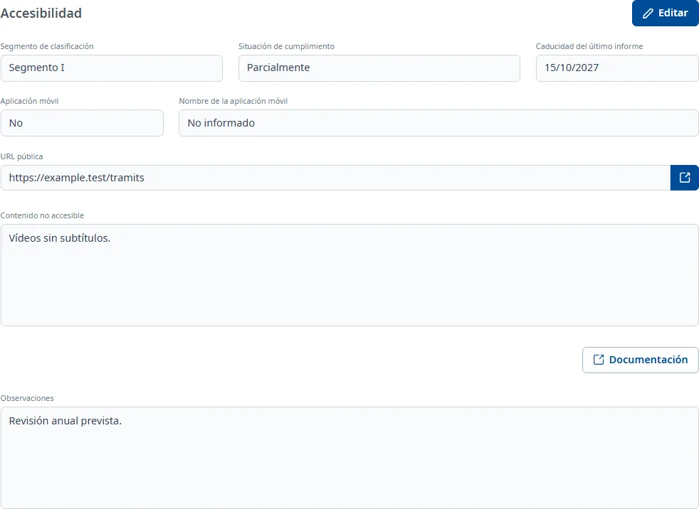

### Accesibilidad

#### Objetivo

Anotar la situación de accesibilidad de la aplicación: el segmento de clasificación, el
cumplimiento, la caducidad del último informe, la aplicación móvil, la URL pública y el contenido
no accesible.

#### Cómo se accede

En la ficha de la aplicación, elija la pestaña **Accesibilidad** (vea
[Cómo funciona la ficha](overview.md)).

#### Acciones disponibles

- **Editar**: pone la pestaña en edición.
- **Guardar** y **Cancelar**, en edición.
- **Documentación**: todavía no está implementada; solo muestra un aviso.
- El icono de enlace junto a **URL pública** abre la dirección en una pestaña nueva, si es válida.

#### Formulario

En consulta, los datos vacíos dicen «No informado». En edición, todos los campos son opcionales:

- **Segmento de clasificación**: desplegable con búsqueda.
- **Situación de cumplimiento**: desplegable con búsqueda.
- **Caducidad del último informe**: fecha, dd/mm/aaaa.
- **Aplicación móvil**: **Sí** o **No**.
- **Nombre de la aplicación móvil**: solo se puede escribir si **Aplicación móvil** es **Sí**; si pasa
  a **No**, el nombre se borra. Como máximo 255 caracteres.
- **URL pública**: debe empezar por `http://` o `https://`, con un máximo de 255 caracteres.
- **Contenido no accesible**: texto con formato.
- **Observaciones**: texto con formato.

Un **Segmento de clasificación** o una **Situación de cumplimiento** ya guardados no se pueden
volver a dejar en blanco: si los borra, vuelven al valor guardado y aparece un aviso. Sí puede
elegir otro valor.

#### Guardar

Haga clic en **Guardar**. Si un dato no es correcto, el mensaje aparece en rojo bajo el campo, por
ejemplo «Introduce una URL HTTP o HTTPS válida». Si todo es correcto, la pestaña vuelve a consulta y
aparece el aviso **Cambios guardados**. **Cancelar** deshace los cambios.

#### Condiciones y permisos

- La pestaña solo aparece si su usuario tiene permiso para el área de accesibilidad.
- En una aplicación dada de baja no aparece **Editar**.
- La pestaña aparece como incompleta («faltan campos obligatorios») mientras falten los datos que
  INVAI considera obligatorios.
- Si los datos o los catálogos no se pueden cargar, aparece un aviso con un botón para volver a
  cargarlos.
