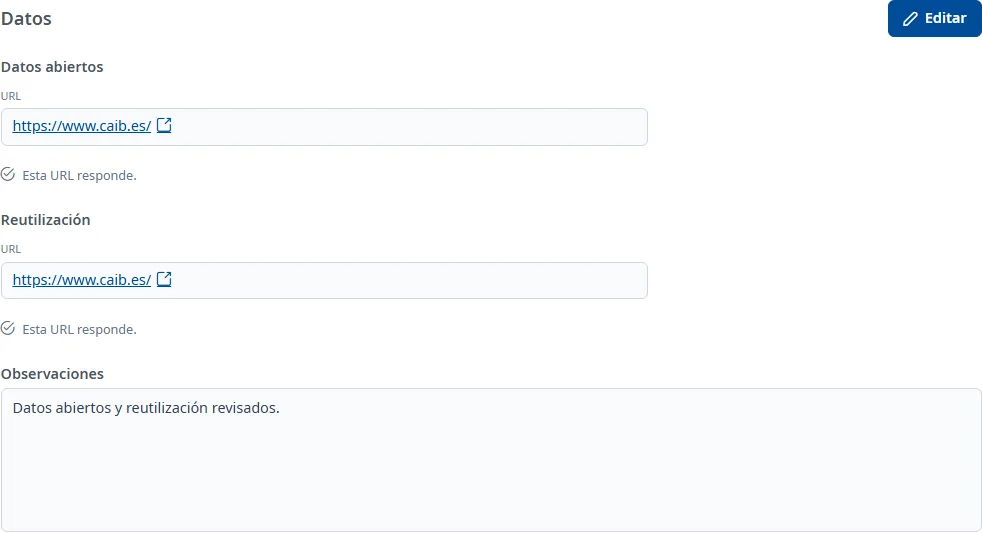

### Datos

#### Objetivo

Consultar los enlaces de datos abiertos y reutilización de la aplicación, comprobar si responden y
anotar observaciones.

#### Cómo se accede

En la ficha de la aplicación, elija la pestaña **Datos** (vea
[Cómo funciona la ficha](overview.md)).

#### Acciones disponibles

- **Editar**: pone la pestaña en edición.
- **Guardar**: guarda las observaciones y las nuevas URL que haya indicado.
- **Cancelar**: deshace los cambios que aún no se han guardado.
- El enlace **URL** de cada fuente abre la dirección en una pestaña nueva.
- **Vuelve a cargar los datos**: vuelve a intentar cargar una pestaña que ha fallado.

#### Formulario

##### Datos abiertos y Reutilización

Cada fuente muestra su **URL** actual. Si no hay dirección, dice «No disponible»; si todavía no se
conoce, «Se conocerá cuando se guarden los datos de la pestaña.».

INVAI comprueba cada dirección por separado. Mientras lo hace dice «Comprobando si esta URL
responde…» y después indica «Esta URL responde.», «Esta URL no responde.» o que no se ha podido
comprobar. Una dirección que no responde sigue siendo un enlace que puede abrir.

En edición, para cada fuente:

- **Indicar la URL manualmente**: opcional; márquelo para sustituir la dirección actual.
- **Nueva URL**: obligatoria solo cuando ha marcado la casilla. Debe empezar por `http://` o
  `https://` en minúsculas, sin espacios dentro de la dirección, y tener como máximo 500 caracteres.

Puede cambiar una sola fuente. Si no marca la casilla de una fuente, se conserva su dirección
actual. Al volver a editar, las casillas están desmarcadas y los campos de nueva URL, vacíos: la
dirección guardada sigue apareciendo en **URL**.

##### Observaciones

- **Observaciones**: opcionales, con texto con formato. En consulta, si están vacías, dicen «No
  informado».

#### Guardar

Haga clic en **Guardar**. Si ha marcado una casilla sin indicar la nueva dirección, aparece «Indica
la nueva URL o desmarca «Indicar la URL manualmente».» bajo el campo. Las direcciones con formato
incorrecto o demasiado largas también muestran su error.

Al guardar se comprueba si las nuevas direcciones responden. Una URL con formato válido se guarda
aunque no responda: el aviso dice qué fuente debe revisar. Si no hay este problema, aparece
**Cambios guardados**. La pestaña vuelve a consulta.

**Cancelar** recupera las observaciones y las direcciones que ya estaban guardadas. Los cambios de
la pestaña se guardan por separado de los del resto de la ficha.

#### Condiciones y permisos

- La pestaña solo aparece si su usuario tiene permiso para el área de datos.
- En una aplicación dada de baja no aparece **Editar**.
- Si el registro de datos está dado de baja, se puede consultar pero no modificar.
- Si no se pueden cargar los datos, use **Vuelve a cargar los datos**. Una comprobación de URL
  fallida no impide consultar la otra fuente.
