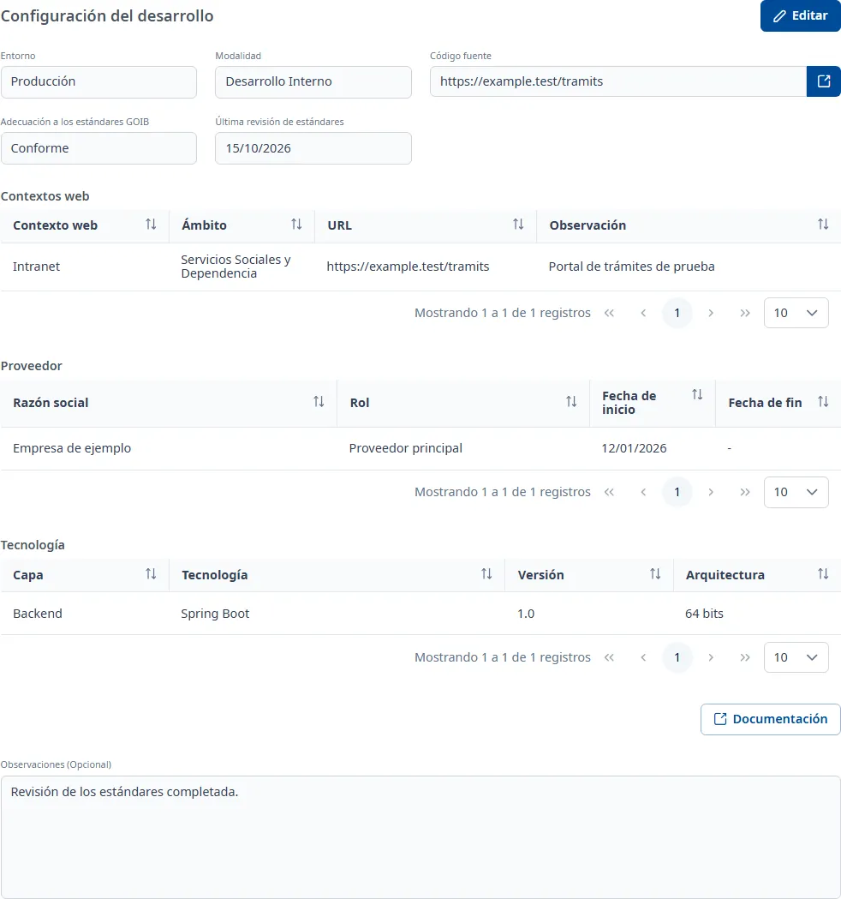

### Desarrollo

#### Objetivo

Recoger cómo se desarrolla la aplicación: el entorno, la modalidad, el código fuente, la adecuación
a los estándares del Govern, y los contextos web, los proveedores y las tecnologías que utiliza.

#### Cómo se accede

En la ficha de la aplicación, elija la pestaña **Desarrollo** (vea
[Cómo funciona la ficha](overview.md)). La pestaña se titula **Configuración del desarrollo**.

#### Acciones disponibles

- **Editar**: pone la pestaña en edición.
- **Guardar** y **Cancelar**, en edición.
- El icono de enlace junto a **Código fuente** abre el repositorio en una pestaña nueva, si la
  dirección es válida.
- **Documentación**: todavía no está implementada; solo muestra un aviso.
- El botón **+** de **Contextos web**, **Proveedor** y **Tecnología**, en edición: añade un registro.
- Los tres puntos de cada fila, en edición: **Consultar**, **Editar** y **Dar de baja**.

En consulta, cada registro se abre con doble clic o con <kbd>Intro</kbd> en la fila.

#### Tabla de resultados

##### Contextos web

- **Contexto web**: los verificados en la pestaña [Seguridad](security.md) llevan el texto «Verificado».
- **Ámbito**
- **URL**
- **Observación**

##### Proveedor

- **Razón social**
- **Rol**
- **Fecha de inicio**
- **Fecha de fin**

##### Tecnología

- **Capa**
- **Tecnología**
- **Versión**
- **Arquitectura**

#### Formulario

##### Datos del desarrollo

Obligatorios:

- **Entorno**: desplegable con búsqueda.
- **Modalidad**
- **Código fuente**: la dirección del repositorio; debe empezar por `http://` o `https://`, sin
  espacios y con un máximo de 1000 caracteres.
- **Adecuación a los estándares GOIB**
- **Última revisión de estándares**: fecha, dd/mm/aaaa.

Opcionales:

- **Observaciones (Opcional)**: texto con formato.

##### Añadir o editar un proveedor

Obligatorios:

- **Razón social**: como máximo 255 caracteres.
- **Rol**

Opcionales:

- **Fecha de inicio**
- **Fecha de fin**: no puede ser anterior a la de inicio.

##### Añadir o editar una tecnología

Obligatorios:

- **Tecnología**: la **Capa** se rellena sola y no se puede modificar aquí.
- **Versión**: como máximo 255 caracteres.
- **Arquitectura**: como máximo 255 caracteres.

##### Añadir o editar un contexto web

Obligatorios:

- **Contexto web**
- **Ámbito**

Opcionales:

- **URL**: debe empezar por `http://` o `https://`, con un máximo de 255 caracteres.
- **Observaciones**

Un contexto web nuevo queda pendiente de verificar en la pestaña [Seguridad](security.md).

##### Dar de baja un registro

Elija **Dar de baja** en el menú de la fila y confírmelo.

#### Guardar

**Guardar** guarda los datos del desarrollo. Si falta alguno, aparece «Campo obligatorio» bajo el
campo; si todo es correcto, la pestaña vuelve a consulta y aparece el aviso **Cambios guardados**.
**Cancelar** deshace estos cambios.

Los contextos web, los proveedores y las tecnologías se guardan al confirmar cada ventana:
**Cancelar** no los deshace. Si cierra una ventana de edición con cambios sin guardar, le pregunta si
los quiere **Descartar** o **Guardar**.

#### Condiciones y permisos

- La pestaña solo aparece si su usuario tiene permiso para el área de desarrollo.
- En una aplicación dada de baja no aparece **Editar**; los registros se pueden consultar igualmente.
- Para gestionar los contextos web hace falta que la aplicación tenga las fichas de Desarrollo y de
  Seguridad; si no, aparece un aviso que pide guardar primero sus datos generales.
- La pestaña aparece como incompleta («faltan campos obligatorios») mientras falte algún dato
  obligatorio.
