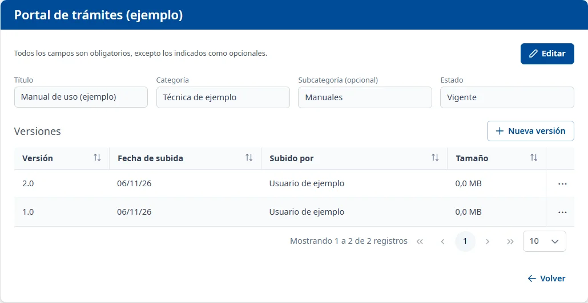

### Detalle de un documento

#### Objetivo

Consultar o modificar los datos de un documento y conservar sus versiones, con su fichero, la fecha
de subida y el usuario que lo subió.

#### Cómo se accede

En **Adjuntos**, dentro de [Documentación](documentation.md), haga doble clic o pulse
<kbd>Intro</kbd> en la fila, o elija **Consultar** en el menú de tres puntos. Se abre una pantalla con
el nombre de la aplicación en la cabecera, los datos del documento y la tabla **Versiones**.

#### Acciones disponibles

- **Editar**: permite cambiar el título, la clasificación y el estado del documento.
- **Guardar**: guarda estos cambios.
- **Cancelar**: recupera los datos guardados y vuelve a consulta.
- **Nueva versión**: abre una ventana para añadir un fichero nuevo al mismo documento.
- Los tres puntos de cada versión: **Descargar** descarga ese fichero y **Ver** lo abre en una
  pestaña nueva.
- **Volver**: vuelve a la pestaña **Documentación** de la aplicación.
- **Volver a intentarlo**: vuelve a cargar un documento que no se ha podido abrir.

Una versión también se abre con doble clic o con <kbd>Intro</kbd> en su fila.

#### Tabla de resultados

**Versiones** muestra, inicialmente, las subidas más recientes primero:

- **Versión**
- **Fecha de subida**
- **Subido por**
- **Tamaño**: tamaño del fichero en MB.

Puede ordenar por estas columnas y pasar de página. Cada versión conserva su propio fichero;
añadir otra no borra las anteriores.

#### Formulario

##### Editar los datos del documento

Obligatorios:

- **Título**: como máximo 150 caracteres.
- **Categoría**
- **Estado**: **Vigente**, **En revisión** u **Obsoleto**.

Opcionales:

- **Subcategoría (opcional)**: entre las de la categoría elegida. Cambiar la categoría borra la
  subcategoría anterior. Si el documento ya pertenece a una categoría o subcategoría dada de baja,
  el valor actual se conserva en la lista de opciones.

##### Añadir una versión

Obligatorios:

- **Versión**: como máximo 20 caracteres; no puede repetir una etiqueta que ya tenga el documento.
- **Fichero**: como máximo 5 MB y en uno de los formatos admitidos por el selector.

Haga clic en **Guarda** para añadirla o en **Cancela** para cerrar la ventana.

#### Guardar

**Guardar** en la cabecera guarda los datos del documento y muestra **Documento guardado**. Si
falta un campo obligatorio o el título es demasiado largo, el mensaje aparece bajo el campo.

La ventana **Nueva versión** se guarda por separado y muestra **Versión añadida**. La versión nueva
pasa a ser la vigente de la lista de adjuntos. Si la etiqueta se repite, aparece «Esta versión ya
existe.». Un fichero demasiado grande o con formato no admitido se rechaza con un aviso antes de
guardar.

Si intenta salir con cambios sin guardar, el aviso **Cambios sin guardar** ofrece **Seguir editando**
o **Descarta los cambios**. **Cancelar** los datos del documento no deshace una versión ya añadida.

#### Condiciones y permisos

- Solo puede consultar los documentos que su usuario tiene permiso para leer.
- En una aplicación dada de baja, o si el documento está eliminado, la pantalla indica que es de
  solo lectura: puede consultar y abrir las versiones, pero no editar ni añadir otras.
- Para añadir una versión deben haberse cargado los formatos admitidos. Si no se pueden cargar,
  el selector de ficheros queda indisponible con su aviso.
