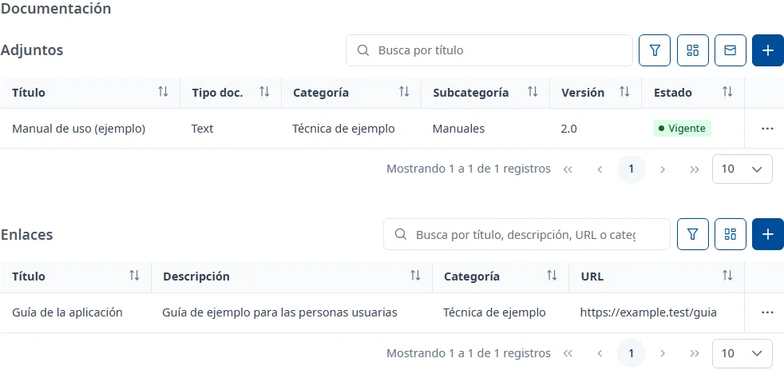
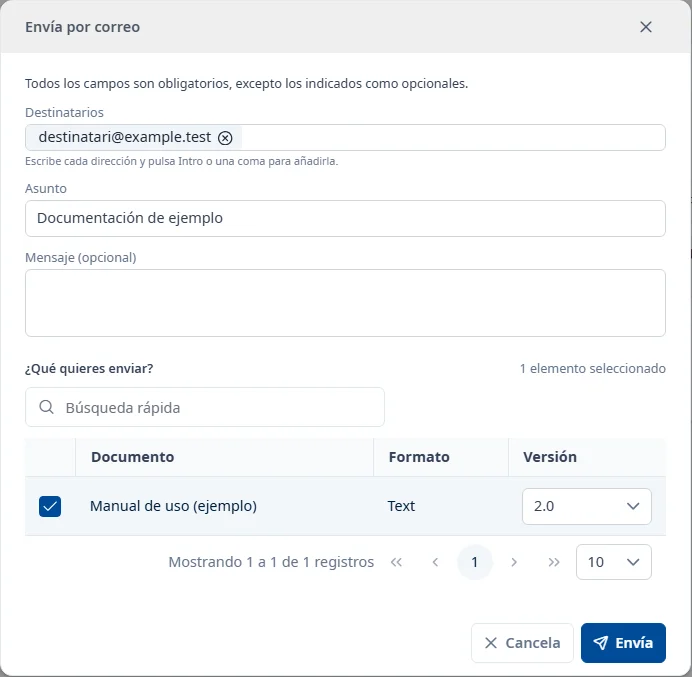

### Documentación

#### Objetivo

Consultar los ficheros y enlaces de la aplicación, clasificarlos y enviar versiones de los adjuntos
por correo.

#### Cómo se accede

En la ficha de la aplicación, elija la pestaña **Documentación** (vea
[Cómo funciona la ficha](overview.md)). Hay dos listas independientes: **Adjuntos** y **Enlaces**.

#### Acciones disponibles

##### Adjuntos

- El botón **+**, **Añade un adjunto**: abre el formulario para cargar un fichero.
- El icono del sobre, **Envía adjuntos por correo**: abre **Envía por correo**.
- El botón de filtros, **Filtros de los adjuntos**: muestra u oculta el buscador.
- **Columnas de los adjuntos**: elige las columnas visibles.
- Los tres puntos de la fila: **Consultar** abre [Detalle de un documento](document-detail.md),
  **Descargar** descarga el fichero de la versión vigente y **Eliminar** pide confirmación para
  eliminar el documento. **Descargar** solo aparece si el documento tiene una versión vigente.

El documento también se abre con doble clic o con <kbd>Intro</kbd> en la fila.

##### Enlaces

- El botón **+**, **Añade un enlace**: abre el formulario de alta.
- **Filtros de los enlaces**: muestra u oculta el buscador.
- **Columnas de los enlaces**: elige las columnas visibles.
- Los tres puntos de la fila: **Consultar** abre los datos del enlace y **Eliminar** pide
  confirmación para eliminarlo.
- La **URL** abre la web en una pestaña nueva.

En la consulta del enlace, **Editar** permite modificarlo. La consulta también se abre con doble
clic o con <kbd>Intro</kbd> en la fila.

#### Búsqueda y filtrado

La búsqueda y paginación de una lista no modifican las de la otra. Use **Buscar** para aplicar los
filtros y **Limpiar** para borrarlos.

##### Adjuntos

- Búsqueda rápida: por el **Título** del documento.
- **Tipo de documento**: el formato del fichero, como PDF o Word.
- **Categoría**
- **Subcategoría**: se habilita al elegir una categoría y solo ofrece sus subcategorías.
- **Estado**: **Vigente**, **En revisión** u **Obsoleto**.

Cambiar la categoría borra la subcategoría seleccionada.

##### Enlaces

- Búsqueda rápida: por el título, la descripción, la URL o la categoría.
- **Categoría**

#### Tabla de resultados

##### Adjuntos

- **Título**
- **Tipo doc.**: formato de la versión vigente.
- **Categoría**
- **Subcategoría**
- **Versión**: etiqueta de la versión vigente.
- **Estado**: estado documental, con su texto.

##### Enlaces

- **Título**
- **Descripción**
- **Categoría**
- **URL**

Puede ordenar las columnas que tienen control de ordenación, cambiar las visibles y pasar de página.

#### Formulario

##### Añadir un adjunto

Obligatorios:

- **Título**: como máximo 150 caracteres.
- **Fichero**: elíjalo con **Adjunta** o arrástrelo a la zona de carga. Como máximo 5 MB, en uno de
  los formatos admitidos que muestra el selector. **Elimina el fichero seleccionado** permite
  cambiarlo antes de guardar. **Tipo de documento** se rellena a partir del fichero.
- **Categoría**
- **Versión**: etiqueta de hasta 20 caracteres, por ejemplo «1.0».

Opcionales:

- **Subcategoría (opcional)**: entre las de la categoría elegida.

El documento nuevo se crea en estado **Vigente**. Para cambiar su estado o añadir versiones, abra
[Detalle de un documento](document-detail.md).

##### Añadir o editar un enlace

Obligatorios:

- **Título**: como máximo 250 caracteres.
- **Categoría**
- **URL**: debe empezar por `http://` o `https://` en minúsculas, sin espacios, con un máximo de
  500 caracteres.

Opcionales:

- **Descripción (opcional)**: como máximo 1000 caracteres.

##### Enviar adjuntos por correo

Obligatorios:

- **Destinatarios**: al menos una dirección válida y como máximo 20. Escriba una dirección y pulse
  <kbd>Intro</kbd>, una coma o un punto y coma para añadirla. Las direcciones repetidas cuentan una
  sola vez; cada dirección puede tener como máximo 320 caracteres.
- **Asunto**: como máximo 250 caracteres, sin saltos de línea. Inicialmente incluye el código de la
  aplicación y puede cambiarlo.
- En **¿Qué quieres enviar?**, seleccione al menos un documento con fichero. La tabla muestra
  **Selección**, **Documento**, **Formato** y **Versión**. El total de ficheros seleccionados no
  puede superar los 15 MB.

Opcionales:

- **Mensaje (opcional)**: como máximo 4000 caracteres.

La búsqueda rápida de esta ventana busca por el título. Puede seleccionar documentos de varias
páginas: la selección se conserva al buscar y paginar. Inicialmente se envía la versión vigente;
junto a cada documento seleccionado puede elegir otra. Si no se pueden cargar las versiones, un
aviso indica que se enviará la vigente. Los enlaces no se pueden seleccionar como adjuntos.

**Envía** envía el correo y muestra **Correo enviado** al terminar. **Cancela** cierra la ventana.
Si el envío falla, la ventana se mantiene abierta con los datos para poder volver a intentarlo.

#### Guardar

Cada alta, modificación o eliminación se confirma en su ventana y se aplica inmediatamente.
**Documentación** no tiene un botón de guardar conjunto. Al añadir un adjunto o guardar un enlace,
la lista correspondiente se actualiza y aparece el aviso de la operación.

Las eliminaciones necesitan confirmación. Cerrar o cambiar de pestaña no deshace una operación ya
confirmada.

#### Condiciones y permisos

- Todo el mundo puede abrir la pestaña, pero solo se muestran los documentos de las categorías que
  su usuario puede consultar. También debe tener permiso para los documentos que envía por correo.
- En una aplicación dada de baja se puede consultar y descargar; los botones de alta y eliminación
  no aparecen.
- Para adjuntar ficheros deben haberse cargado los formatos admitidos. Si fallan, el selector avisa
  de que no se puede adjuntar ningún fichero.
- Si no hay resultados, la lista indica «No hay ningún adjunto.» o «No hay ningún enlace.».
