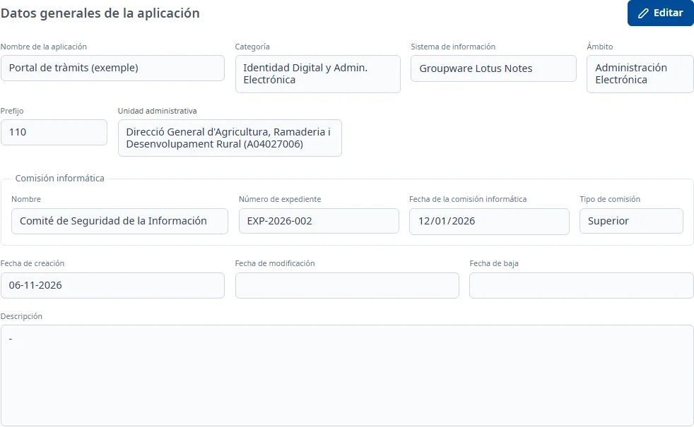

### General

#### Objetivo

Consultar y modificar los datos generales de la aplicación (nombre, clasificación, unidad
administrativa y comisión informática), y darla de baja o volver a darla de alta.

#### Cómo se accede

Es la primera pestaña de la ficha y la que se abre al entrar en una aplicación (vea
[Cómo funciona la ficha](overview.md)).

#### Acciones disponibles

- **Editar**: pone la pestaña en edición.
- **Guardar** y **Cancelar**, en edición: guardan o deshacen los cambios.
- **Dar de baja**, en edición: da de baja la aplicación (vea más abajo).
- **Restaurar**, en una aplicación dada de baja: la vuelve a dar de alta.

#### Formulario

Los datos aparecen bajo **Datos generales de la aplicación**. En consulta se ven como texto; en
edición, como campos.

Obligatorios:

- **Nombre de la aplicación**
- **Categoría**
- **Sistema de información**
- **Ámbito**
- **Prefijo**: como máximo 3 caracteres.
- **Unidad administrativa**: abra el desplegable y escriba parte del nombre o del código de la
  unidad. Si hay más de 20 resultados, solo se muestran los 20 primeros: concrete la búsqueda.
- **Nombre** de la **Comisión informática**: al elegirla, se rellenan solos el **Número de
  expediente**, la **Fecha de la comisión informática** y el **Tipo de comisión**.

Opcionales:

- **Descripción**: admite texto con formato.

No se pueden modificar nunca la **Fecha de creación**, la **Fecha de modificación** ni la **Fecha de
baja**, ni los datos de la comisión que se rellenan solos.

#### Guardar

Haga clic en **Guardar**. Si falta algún campo obligatorio, aparece «Campo obligatorio» bajo el
campo. Si todo es correcto, la pestaña vuelve a consulta y aparece el aviso **Cambios guardados**.

Si ha cambiado el prefijo, a la aplicación se le asignan los roles de Soffid del prefijo nuevo, y el
aviso dice cuántos se han asignado. Si no se han podido asignar, aparece «Los cambios se han
guardado, pero no se han podido asignar los roles de Soffid del prefijo…».

##### Dar de baja

1. Haga clic en **Editar** y después en **Dar de baja**, debajo de los datos.
2. Confírmelo en la ventana **¿Dar de baja la aplicación?** con **Dar de baja**, o vuelva atrás con
   **Cancelar**.

Aparece el aviso **Aplicación dada de baja** y vuelve a la lista, donde la aplicación ya no aparece
mientras el filtro **Estado** muestre solo las activas.

##### Restaurar

Una aplicación dada de baja muestra «Aplicación está dada de baja» y el botón **Restaurar**. Haga
clic en él y confírmelo en la ventana **¿Dar de alta la aplicación?** con **Dar de alta**. Aparece
el aviso **Aplicación dada de alta**, que dice también cuántos roles de Soffid se le han asignado.

#### Condiciones y permisos

- Todo el mundo puede abrir la pestaña **General**.
- **Editar** y **Dar de baja** no aparecen en una aplicación dada de baja; solo **Restaurar**.
- Si tiene cambios sin guardar en otras pestañas, antes de dar de baja la aplicación le pedirá que
  los guarde o los cancele.
