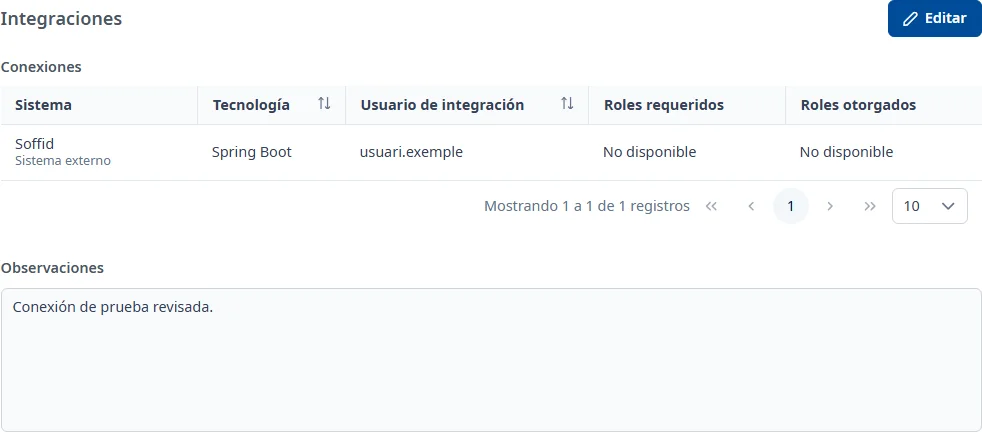

### Integraciones

#### Objetivo

Consultar y gestionar las conexiones de la aplicación con otras aplicaciones del inventario o
sistemas externos, con el usuario de integración, la tecnología y los roles de Soffid que requieren.

#### Cómo se accede

En la ficha de la aplicación, elija la pestaña **Integraciones** (vea
[Cómo funciona la ficha](overview.md)).

#### Acciones disponibles

- **Editar**: pone la pestaña en edición.
- **Guardar**: guarda las observaciones de la pestaña.
- **Cancelar**: recupera las observaciones guardadas.
- El botón **+**, **Añade una conexión**, en edición: abre **Añadir conexión**.
- Los tres puntos de cada fila, en edición: **Consultar**, **Editar** y **Dar de baja**.
- **Vuelve a cargar las integraciones**: vuelve a intentar cargar los datos de la pestaña.

En consulta, haga doble clic o pulse <kbd>Intro</kbd> en la fila para abrir **Consultar conexión**.

#### Tabla de resultados

- **Sistema**: la aplicación del inventario o el sistema externo de la conexión.
- **Tecnología**: la tecnología con la que se hace la conexión.
- **Usuario de integración**: el código de usuario de Soffid.
- **Roles requeridos**: los roles indicados para esta conexión.
- **Roles otorgados**: los roles que Soffid devuelve para el usuario.

Puede ordenar las columnas que muestran el control de ordenación y pasar de página. La ventana de
consulta también muestra **Coincidencia de roles**: «Coinciden», «No coinciden» o «No se ha podido
comprobar».

Un icono de exclamación junto al sistema avisa de que los roles requeridos no coinciden con los
otorgados. Pase el ratón por él o llegue con <kbd>Tab</kbd> para leer su mensaje.

Si no se han podido consultar los roles en Soffid, la consulta lo avisa y la conexión no se puede
editar hasta que vuelva a cargar la pestaña.

#### Formulario

##### Añadir o editar una conexión

Todos los campos son obligatorios:

- **Tipo de sistema**: **Aplicación del inventario** o **Sistema externo**.
- **Aplicación**, si ha elegido una aplicación del inventario: abra la lista y búsquela por nombre o
  código. Debe elegir un resultado.
- **Sistema externo**, si ha elegido este tipo: selecciónelo en el desplegable.
- **Tecnología**: desplegable con búsqueda.
- **Usuario de integración**: búsquelo en Soffid y seleccione una persona de la lista que tenga
  código de usuario. Escribir un nombre sin seleccionarlo no es suficiente.
- **Roles requeridos**: abra la lista, busque por el nombre del rol y seleccione al menos uno. Puede
  elegir varios.

Cambiar el **Tipo de sistema** borra la selección del tipo anterior. Los roles otorgados se
consultan en Soffid; no se editan en este formulario.

##### Dar de baja una conexión

Elija **Dar de baja** y confírmelo. La conexión deja de aparecer en la tabla de conexiones activas.

##### Observaciones

- **Observaciones**: opcionales, con texto con formato.

#### Guardar

Las conexiones se guardan al confirmar su ventana y se dan de baja al confirmar el aviso. Estas
operaciones son inmediatas: **Cancelar** la pestaña no las deshace.

**Guardar** en la cabecera guarda solo las **Observaciones** y muestra **Cambios guardados**. Si
cierra una ventana de edición de conexión con cambios, puede **Descartar** o **Guardar** esos cambios.

#### Condiciones y permisos

- La pestaña solo aparece si su usuario tiene permiso para el área de integraciones.
- En una aplicación dada de baja no aparece **Editar**; las conexiones se pueden consultar.
- Si INVAI pide guardar las observaciones antes de añadir conexiones, hágalo para habilitar el alta.
- Si no se cargan los desplegables de tecnología o sistemas externos, cierre el formulario y vuelva
  a abrirlo.
- La pestaña aparece como incompleta mientras no haya ninguna conexión activa.
