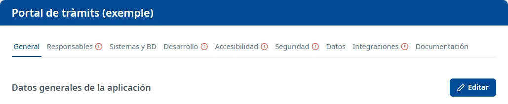

### Cómo funciona la ficha

#### Objetivo

Consultar y completar todos los datos de una aplicación, repartidos en pestañas.

#### Cómo se accede

En la [Lista de aplicaciones](../applications/list.md), haga doble clic en la fila de la aplicación,
sitúese en ella y pulse <kbd>Intro</kbd>, o elija **Consultar** o **Editar** en el menú de la fila.
La ficha se abre en la pestaña **General**, con el nombre de la aplicación como título. La ruta de
navegación muestra **Aplicaciones** y el código de la aplicación; haga clic en **Aplicaciones** para
volver a la lista.

#### Pestañas

- [General](general.md)
- [Responsables](responsible.md)
- [Sistemas y BD](systems-databases.md)
- [Desarrollo](development.md)
- [Accesibilidad](accessibility.md)
- [Seguridad](security.md)
- [Datos](data.md)
- [Integraciones](integrations.md)
- [Documentación](documentation.md)

Un icono de exclamación junto al nombre de una pestaña indica que le faltan datos. Al pasar el ratón
por encima, o al llegar con <kbd>Tab</kbd>, verá el motivo, por ejemplo «La sección Sistemas y BD
está incompleta: no hay ningún sistema activo.». Si los indicadores no se pueden actualizar,
aparece un aviso con el botón **Vuelve a cargar los indicadores**.

#### Consultar y editar

Cada pestaña se abre en consulta y se guarda por separado:

- **Editar** pone la pestaña en edición.
- **Guardar** guarda los cambios de la pestaña. Aparece el aviso **Cambios guardados**.
- **Cancelar** deshace los cambios de la pestaña.

Puede cambiar de pestaña sin perder lo que ha editado. Si quiere salir de la aplicación con cambios
sin guardar, el aviso **Cambios sin guardar** dice qué pestañas debe guardar o cancelar antes;
**Entendido** lo cierra. Si cierra o recarga la pestaña del navegador con cambios, el navegador
también le avisa.

#### Condiciones y permisos

- **General** y **Documentación** las puede abrir todo el mundo. Las demás pestañas solo aparecen si
  su usuario tiene permiso para esa área; si abre su dirección sin permiso, se abre **General**.
- En una aplicación dada de baja, ninguna pestaña muestra **Editar**. Para volver a darla de alta,
  vea [General](general.md).
