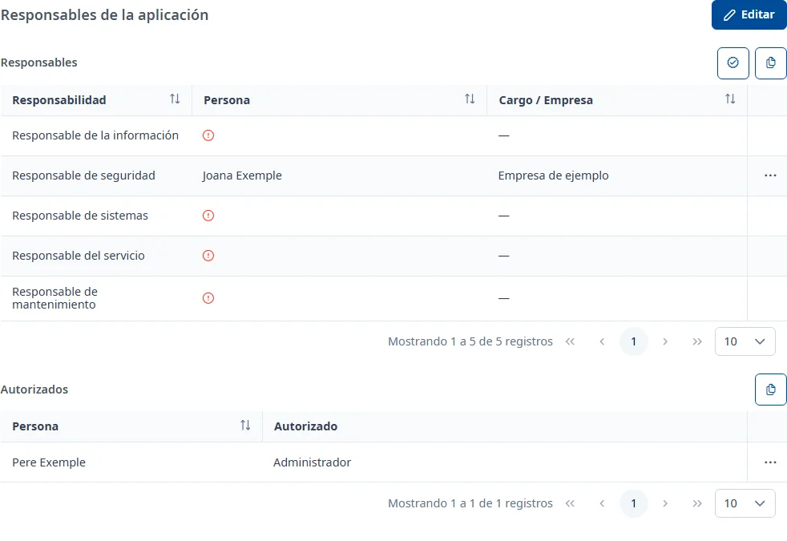

### Responsables

#### Objetivo

Asignar las personas responsables de la aplicación, una para cada tipo de responsabilidad, y las
personas autorizadas, y comprobar que su DIR3 coincide con el de la aplicación.

#### Cómo se accede

En la ficha de la aplicación, elija la pestaña **Responsables** (vea
[Cómo funciona la ficha](overview.md)).

#### Acciones disponibles

En el panel **Responsables**:

- **Validar el DIR3 de la aplicación** (el botón de verificación): comprueba el DIR3 de todos los
  responsables y autorizados con el de la aplicación.
- **Copia la tabla de responsables** (el botón de copiar): copia la página visible de la tabla al
  portapapeles, para pegarla, por ejemplo, en una hoja de cálculo.
- **Añade un responsable** (el botón **+**), en edición.

En el panel **Autorizados**:

- **Copia la tabla de personas autorizadas**.
- **Añade una persona autorizada** (el botón **+**), en edición.

Los tres puntos de cada fila abren el menú del registro:

- **Consultar**: muestra todos los datos de la persona en una ventana. También se abre con doble
  clic o con <kbd>Intro</kbd> en la fila.
- **Editar** y **Dar de baja**, en edición.
- **Confirmar discrepancia DIR3**, en edición, para un responsable de personal CAIB con el DIR3
  pendiente de validar.

#### Tabla de resultados

La tabla **Responsables** tiene una fila para cada tipo de responsabilidad:

- **Responsabilidad**
- **Persona**: el nombre y, para el personal CAIB, el código de usuario debajo. Un icono naranja
  significa «DIR3 no validado»; uno verde, «DIR3 validado manualmente», con el motivo.
- **Cargo / Empresa**: el cargo del personal CAIB o la empresa de las personas externas.

Una responsabilidad sin nadie asignado muestra en **Persona** un icono rojo; al pasar el ratón por
encima, dice «Incompleto».

La tabla **Autorizados** tiene las columnas **Persona** y **Autorizado**, con los tipos de
autorización de cada persona.

#### Formulario

##### Añadir o editar un responsable

1. En **Personal CAIB**, active el interruptor si la persona es personal de la CAIB. Algunas
   responsabilidades lo exigen: entonces el interruptor queda activado y aparece «Esta
   responsabilidad requiere personal CAIB.».
2. Elija la **Responsabilidad**. Solo aparecen las que todavía no tienen a nadie asignado.
3. Elija a la persona:
   - Personal CAIB: en **Persona CAIB**, escriba al menos 3 caracteres del nombre, del código de
     usuario o del correo y elija a la persona de la lista de Soffid. Si quiere, escriba su
     **Cargo**.
   - Persona externa: elija la **Empresa** y después la **Persona**, entre las personas externas de
     esa empresa.
4. El **Correo electrónico** se rellena solo. Si quiere, escriba unas **Observaciones (Opcional)**.
5. Haga clic en **Añadir**.

Al elegir una persona CAIB, INVAI comprueba su DIR3 («Comprobando DIR3…»). Si no coincide con el de
la aplicación, aparece «El DIR3 de la persona no coincide con el de la aplicación.» y el apartado
**Validar manualmente**: si marca la casilla y escribe el **Motivo**, la discrepancia queda
validada; si no, el responsable se guarda con el DIR3 pendiente de validar.

Si todas las responsabilidades ya están asignadas, **Añade un responsable** muestra «Todas las
responsabilidades están asignadas»: primero debe dar de baja una. Al editar un responsable solo se
pueden cambiar el **Cargo** y las **Observaciones**.

##### Añadir o editar una persona autorizada

Los campos son los mismos que para un responsable, sin **Responsabilidad** ni **Cargo**, y con
**Autorizado**, obligatorio: elija uno o más tipos de autorización. Al editarla solo se pueden
cambiar **Autorizado** y las **Observaciones**.

##### Dar de baja

Elija **Dar de baja** en el menú de la fila. En la ventana **¿Dar de baja este registro?**, escriba
unas **Observaciones**, obligatorias, y haga clic en **Dar de baja**. La responsabilidad queda sin
nadie asignado y se puede volver a asignar.

##### Confirmar discrepancia DIR3

Elija **Confirmar discrepancia DIR3** en el menú de la fila. La ventana vuelve a comprobar el DIR3 y
muestra el resultado. Si todavía no coincide, marque la casilla, escriba el **Motivo** y haga clic
en **Confirmar**: el icono de la persona pasa a «DIR3 validado manualmente».

#### Guardar

Cada ventana se guarda al confirmarla (**Añadir**, **Guardar**, **Dar de baja** o **Confirmar**), y
aparece un aviso como «El responsable se ha añadido correctamente.». Los botones **Guardar** y
**Cancelar** de la pestaña solo cierran la edición: **Cancelar** no deshace lo que ya se ha guardado
en las ventanas.

Si cierra una ventana con cambios sin guardar, le pregunta si los quiere **Descartar** o
**Guardar**.

#### Condiciones y permisos

- La pestaña solo aparece si su usuario tiene permiso para consultar los responsables.
- Si su usuario no los puede modificar, al confirmar una ventana aparece «No tienes permisos para
  realizar esta operación.».
- En una aplicación dada de baja no aparecen **Editar**, **Validar el DIR3 de la aplicación** ni los
  botones para añadir; el menú de las filas solo tiene **Consultar**.
- La pestaña aparece como incompleta mientras falte asignar algún tipo de responsabilidad, no haya
  ninguna persona autorizada o haya responsables de personal CAIB con el DIR3 pendiente de validar.
