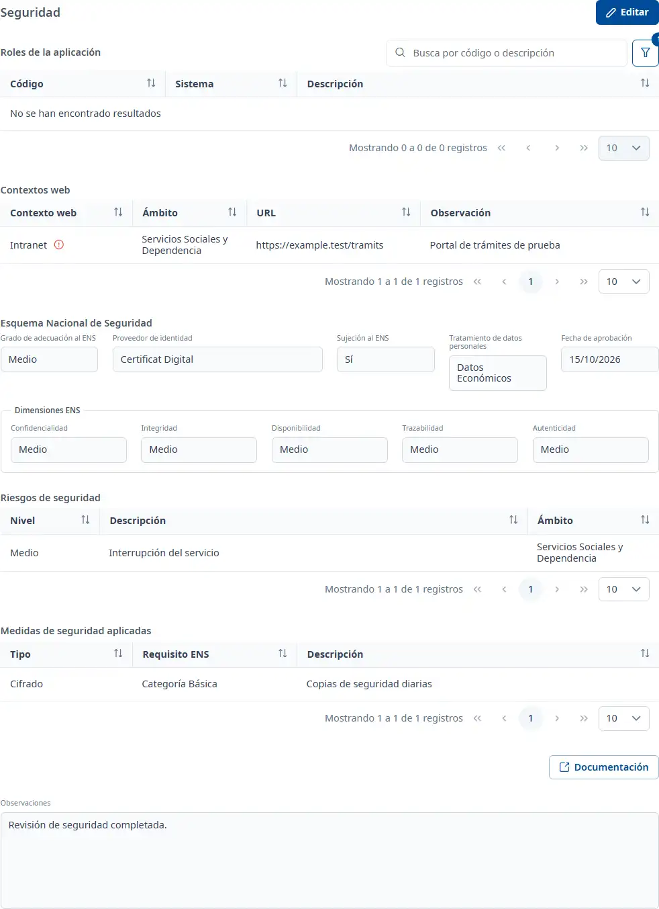

### Seguridad

#### Objetivo

Recoger la seguridad de la aplicación: sus roles de Soffid, los contextos web, la clasificación según
el Esquema Nacional de Seguridad (ENS), los riesgos y las medidas aplicadas.

#### Cómo se accede

En la ficha de la aplicación, elija la pestaña **Seguridad** (vea
[Cómo funciona la ficha](overview.md)).

#### Acciones disponibles

- **Editar**: pone la pestaña en edición.
- **Guardar** y **Cancelar**, en edición.
- **Documentación**: todavía no está disponible; solo muestra un aviso.
- El botón **+** de **Roles de la aplicación**, **Riesgos de seguridad** y **Medidas de seguridad
  aplicadas**, en edición: añade un registro.
- Los tres puntos de cada fila, en edición: **Consultar**, **Editar** y **Dar de baja**, y
  **Validar manualmente** para un rol no validado.
- **Verificar**, en edición, en cada contexto web pendiente de verificar.

En consulta, la ventana **Consulta** de cada registro se abre con doble clic o con <kbd>Intro</kbd>
en la fila.

#### Búsqueda y filtrado

La tabla **Roles de la aplicación** tiene una búsqueda rápida por código o descripción y un
**Buscador** con **Código** y **Sistema**. Por defecto solo muestra los roles del sistema
**weblogic**; **Limpiar** vuelve a él.

#### Tabla de resultados

##### Roles de la aplicación

- **Código**: un icono verde indica validación manual; uno naranja, que el rol no está validado
  porque el código no empieza por el prefijo de la aplicación. El mensaje del icono explica el estado.
- **Sistema**
- **Descripción**

##### Contextos web

- **Contexto web**: un icono verde indica que está verificado; uno de aviso rojo, que está pendiente.
  El mensaje del icono explica el estado; en los verificados muestra el motivo de la verificación.
- **Ámbito**
- **URL**
- **Observación**

Los contextos web se añaden en [Desarrollo](development.md); aquí solo se consultan y se verifican.

##### Riesgos de seguridad

- **Nivel**
- **Descripción**
- **Ámbito**

##### Medidas de seguridad aplicadas

- **Tipo**
- **Requisito ENS**
- **Descripción**

#### Formulario

##### Esquema Nacional de Seguridad

Todos los campos son opcionales:

- **Grado de adecuación al ENS**
- **Proveedor de identidad**
- **Sujeción al ENS**
- **Tratamiento de datos personales**
- **Fecha de aprobación**: fecha, dd/mm/aaaa.

Dentro de **Dimensiones ENS**, también opcionales:

- **Confidencialidad**
- **Integridad**
- **Disponibilidad**
- **Trazabilidad**
- **Autenticidad**

Si el servidor tiene más de una clasificación ENS activa, aparece «Datos ENS inconsistentes» y estos
campos no se pueden editar hasta que se corrijan los datos.

Debajo, **Observaciones** admite texto con formato.

##### Añadir un rol

En **Código**, abra la lista y escriba el código del rol, por ejemplo con el prefijo de la
aplicación, y elíjalo entre los roles de Soffid. **Sistema** y **Descripción** se rellenan solos. Si
el código no empieza por el prefijo de la aplicación, el rol se guarda como validado manualmente a su
nombre.

##### Añadir o editar un riesgo

Todos los campos son opcionales:

- **Nivel**
- **Ámbito**
- **Descripción**

##### Añadir o editar una medida

Todos los campos son opcionales:

- **Tipo**
- **Requisito ENS**
- **Descripción**

##### Verificar un contexto web

Haga clic en **Verificar** en la fila, escriba el **Motivo de la verificación**, obligatorio, y haga
clic en **Verificar**. El icono pasa a verde.

##### Dar de baja un registro

Elija **Dar de baja** en el menú de la fila y confírmelo. El registro deja de aparecer en la tabla.

#### Guardar

**Guardar** guarda la clasificación ENS y las **Observaciones**, y aparece el aviso **Cambios
guardados**. **Cancelar** los deshace. Los roles, los riesgos, las medidas y las verificaciones se
guardan al confirmar cada ventana: **Cancelar** no los deshace.

#### Condiciones y permisos

- La pestaña solo aparece si su usuario tiene permiso para el área de seguridad, que incluye asignar
  los roles de Soffid.
- En una aplicación dada de baja no aparece **Editar**; los registros se pueden consultar igualmente.
- Si los botones **+** de riesgos y medidas aparecen desactivados, la aplicación todavía no tiene la
  ficha de seguridad: guarde primero los datos generales de Seguridad.
- La pestaña aparece como incompleta mientras falte al menos un contexto web, una clasificación ENS o
  un riesgo activo, y avisa si hay contextos web pendientes de verificar.
