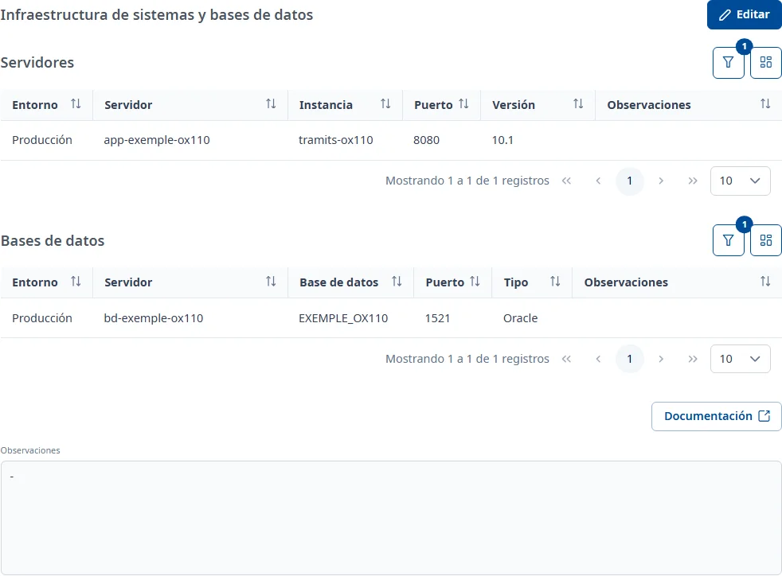

### Sistemas y BD

#### Objetivo

Relacionar la aplicación con los servidores y las bases de datos en los que funciona, y anotar
observaciones.

#### Cómo se accede

En la ficha de la aplicación, elija la pestaña **Sistemas y BD** (vea
[Cómo funciona la ficha](overview.md)). La pestaña se titula **Infraestructura de sistemas y bases
de datos**.

#### Acciones disponibles

- **Editar**: pone la pestaña en edición.
- **Guardar** y **Cancelar**, en edición.
- **Documentación**, debajo: todavía no está implementada; solo muestra un aviso.

En los paneles **Servidores** y **Bases de datos**:

- **Filtros** (el botón del embudo): abre y cierra el **Buscador** del panel.
- **Mostrar / ocultar columnas**: elige las columnas de la tabla.
- **Añadir** (el botón **+**), en edición: relaciona un servidor o una base de datos.

En edición, los tres puntos de cada fila abren el menú del registro, con **Consultar** y
**Eliminar**. En consulta, la ventana **Consultar** se abre con doble clic o con <kbd>Intro</kbd> en
la fila.

#### Búsqueda y filtrado

Los dos paneles tienen el **Buscador** plegado; por defecto muestran solo las relaciones activas.

- **Servidores**: **Entorno**, **Servidor**, **Instancia**, **Puerto**, **Versión**, **Estado** y
  **Observaciones**.
- **Bases de datos**: **Entorno**, **Servidor**, **Versión**, **Base de datos**, **Servicio**,
  **Puerto**, **Tipo**, **Estado** y **Observaciones**.

De momento solo se aplican **Servidor** o **Base de datos** y **Estado**. Si rellena otro filtro,
aparece «El filtro «…» aún no está soportado por el servidor y no se aplicará.». **Buscar** aplica
los filtros y **Limpiar** los devuelve al estado **Activo**.

#### Tabla de resultados

**Servidores**:

- **Entorno**
- **Servidor**
- **Instancia**
- **Puerto**
- **Versión**
- **Observaciones**

**Bases de datos**:

- **Entorno**
- **Servidor**
- **Base de datos**
- **Puerto**
- **Tipo**
- **Observaciones**

La columna **Estado** («Activo» o «Inactivo») solo aparece cuando vacía el filtro **Estado**. Todas
las columnas se pueden ordenar.

#### Formulario

##### Relacionar un servidor o una base de datos

1. Haga clic en **Editar** y después en el botón **+** del panel.
2. En la ventana **Añadir servidor a la aplicación** (o **Añadir base de datos a la aplicación**),
   busque el registro con la búsqueda rápida o con el **Buscador**. Solo aparecen los servidores o
   las bases de datos activos que todavía no están relacionados con la aplicación.
3. Seleccione uno haciendo clic en la fila o con <kbd>Intro</kbd>.
4. Haga clic en **Añadir**.

Aparece el aviso «El servidor se ha añadido correctamente a la aplicación.» (o «La base de
datos…»). No hay ningún otro campo que rellenar: los datos del servidor o de la base de datos se
mantienen en **Mantenimientos**.

##### Eliminar una relación

En edición, elija **Eliminar** en el menú de la fila y confírmelo con **Dar de baja**. La relación
queda inactiva y deja de aparecer en la lista mientras el filtro **Estado** muestre solo las
activas.

##### Observaciones

Debajo de los paneles, **Observaciones** admite texto con formato. En edición se pueden escribir; si
el texto es demasiado largo, aparece «El texto supera el tamaño máximo permitido…».

#### Guardar

**Guardar** guarda las **Observaciones** y aparece el aviso **Cambios guardados**. Las relaciones se
guardan en el momento de añadirlas o eliminarlas: **Cancelar** solo deshace los cambios de las
**Observaciones**.

#### Condiciones y permisos

- La pestaña solo aparece si su usuario tiene permiso para el área de sistemas.
- En una aplicación dada de baja no aparece **Editar**; las filas se pueden consultar igualmente.
- Si el botón **+** aparece desactivado en edición, la aplicación todavía no tiene la ficha de
  sistemas y bases de datos: escriba las **Observaciones**, haga clic en **Guardar** y vuelva a hacer
  clic en **Editar**.
- La pestaña aparece como incompleta mientras no haya ningún servidor o ninguna base de datos
  activos.
