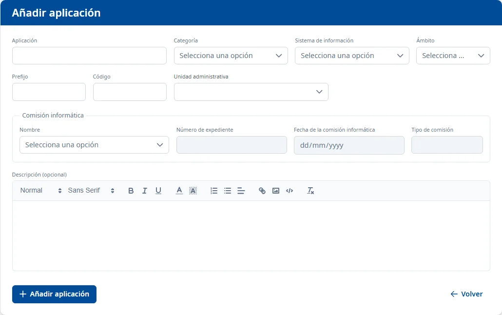

### Alta de una aplicación

#### Objetivo

Añadir una aplicación nueva al inventario con los datos básicos. El resto de la ficha (responsables,
sistemas, desarrollo…) se completa después desde la ficha de la aplicación.

#### Cómo se accede

En la [Lista de aplicaciones](list.md), haga clic en el botón **+** de la barra de herramientas.

#### Acciones disponibles

- **Añadir aplicación**: da de alta la aplicación (vea [Guardar](#guardar)).
- **Volver**: vuelve a la lista sin guardar nada.

#### Formulario

Obligatorios:

- **Aplicación**: el nombre de la aplicación.
- **Categoría**
- **Sistema de información**
- **Ámbito**
- **Prefijo**: como máximo 3 caracteres.
- **Código**: entre 4 y 10 caracteres.
- **Unidad administrativa**: abra el desplegable y escriba parte del nombre o del código de la
  unidad. Si hay más de 20 resultados, solo se muestran los 20 primeros: concrete la búsqueda.
- **Nombre** de la **Comisión informática**: al elegirla, se rellenan solos el **Número de
  expediente**, la **Fecha de la comisión informática** y el **Tipo de comisión**, que aparecen en
  gris y no se pueden escribir.

Opcionales:

- **Descripción (opcional)**

#### Guardar

Haga clic en **Añadir aplicación** o pulse <kbd>Intro</kbd> en un campo de texto.

- Si falta algún campo obligatorio, aparece «Campo obligatorio» bajo el campo. Si el prefijo o el
  código no tienen la longitud correcta, el mensaje lo dice («El prefijo debe tener como máximo 3
  caracteres», «El código debe tener al menos 4 caracteres»).
- Si todo es correcto, vuelve a la lista con el aviso **Aplicación añadida**, que dice cuántos
  roles de Soffid se han asignado a la aplicación (por ejemplo «Aplicación añadida correctamente con
  1 rol de Soffid asignado.»), o que no hay ninguno con su prefijo.
- Si la aplicación se ha añadido pero los roles no se han podido asignar, aparece «La aplicación se
  ha añadido, pero no se han podido asignar sus roles de Soffid.».
- Si no se ha podido añadir, aparece «No se ha podido añadir la aplicación.».

#### Condiciones y permisos

- El prefijo no puede ser el de otra aplicación: si lo es, el alta no se hace y un mensaje se lo
  indica.
- Al dar de alta la aplicación se le asignan los roles de Soffid que tienen su prefijo.
