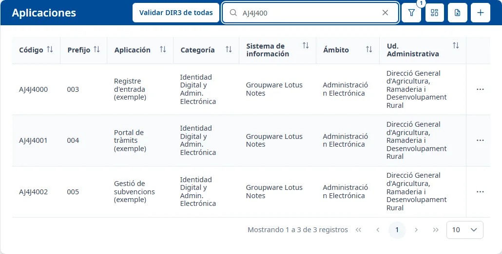
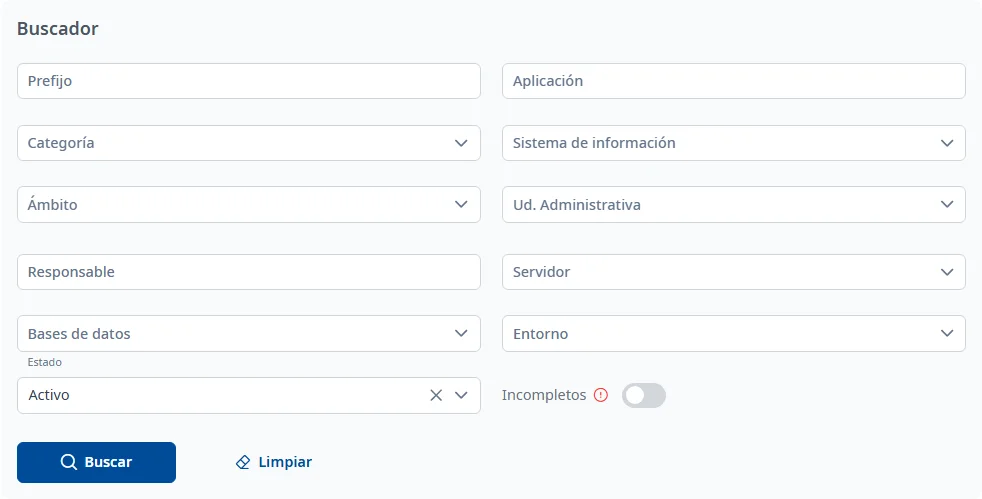
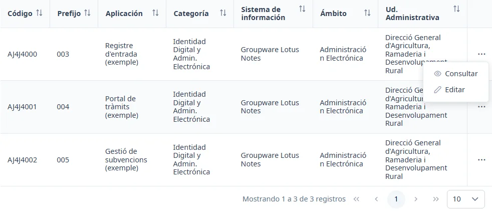

### Lista de aplicaciones

#### Objetivo

Consultar las aplicaciones del inventario, encontrar una, abrir su ficha o dar de alta una nueva.

#### Cómo se accede

En el menú lateral, elija **Aplicaciones**. También es la página que se abre al entrar en INVAI y al
hacer clic en los logotipos de la cabecera.

#### Acciones disponibles

- **Validar DIR3 de todas**: comprueba la unidad administrativa de cada aplicación activa con el
  directorio DIR3 (vea más abajo).
- **Búsqueda rápida** (el cuadro de la lupa): busca mientras escribe.
- **Filtros** (el botón del embudo): abre y cierra el **Buscador**.
- **Mostrar / ocultar columnas**: elige las columnas de la tabla.
- **Exportar Excel (.xls)**: todavía no está implementado; solo muestra un aviso.
- **Añadir** (el botón **+**): abre el [Alta de una aplicación](create.md).

##### Validar DIR3 de todas

Haga clic en **Validar DIR3 de todas** para comprobar con el directorio DIR3 la unidad
administrativa de todas las aplicaciones activas. Mientras dura, el botón muestra cuántas lleva
(«Validando DIR3: 12 de 40»). Al terminar, el aviso **Validación DIR3 completada** dice cuántas
aplicaciones tienen discrepancias y, si las hay, cuántas no se han podido validar.

#### Búsqueda y filtrado

La búsqueda rápida busca mientras escribe, sin pulsar <kbd>Intro</kbd>, y vuelve a la primera
página. La cruz del cuadro la borra.

El botón del embudo abre el **Buscador**, con estos filtros:

- **Prefijo**
- **Aplicación**
- **Categoría**
- **Sistema de información**
- **Ámbito**
- **Ud. Administrativa**: escriba parte del nombre de la unidad para buscarla.
- **Responsable**: escriba parte del nombre y elija a la persona de la lista; el texto escrito sin
  elegir a nadie no cuenta.
- **Servidor**
- **Bases de datos**
- **Entorno**
- **Estado**: **Activo** por defecto, así que la lista muestra solo las aplicaciones activas.
- **Incompletos**: si lo activa, muestra solo las aplicaciones que tienen alguna sección de la
  ficha por completar.

**Buscar** aplica los filtros y **Limpiar** los devuelve a sus valores iniciales y vuelve a buscar.
El número sobre el embudo indica cuántos filtros se aplicaron en la última búsqueda; por el
**Estado**, aparece un **1** desde el principio. Más detalles en
[Trucos de la interfaz](../getting-started/interface-tips.md).

#### Tabla de resultados

Columnas que se ven por defecto:

- **Código**
- **Prefijo**
- **Aplicación**
- **Categoría**
- **Sistema de información**
- **Ámbito**
- **Ud. Administrativa**

Columnas ocultas, que puede mostrar con **Mostrar / ocultar columnas**:

- **Comisión informática**
- **Estado**, que se muestra sola cuando vacía el filtro **Estado**.

Todas las columnas se pueden ordenar haciendo clic en el título. Debajo de la tabla se puede
cambiar de página y elegir cuántas filas se ven (10 por defecto).

Para abrir una aplicación, haga doble clic en la fila, o sitúese en ella con <kbd>Tab</kbd> y pulse
<kbd>Intro</kbd>: se abre su ficha, en la pestaña **General**. Los tres puntos del final de la fila
abren el menú de la aplicación:

- **Consultar**: abre la ficha para consultarla.
- **Editar**: abre la pestaña **General** de la ficha directamente en edición.

#### Condiciones y permisos

- **Editar** no está disponible para las aplicaciones inactivas.
- **Validar DIR3 de todas** solo comprueba las aplicaciones activas.
- Si la lista no se puede cargar, aparece el aviso «No se han podido cargar las aplicaciones.».
