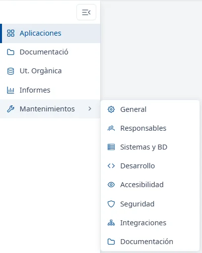
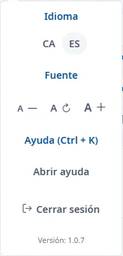

### Cabecera y menú de usuario

#### Objetivo

Conocer lo que aparece en todas las páginas de INVAI (la cabecera, el menú lateral y el pie) y las
opciones del menú de usuario.

#### Cómo se accede

La cabecera, el menú lateral y el pie están en todas las páginas. El menú de usuario se abre
haciendo clic en su nombre, arriba a la derecha.

#### Cabecera

- **Logotipos del Govern y de INVAI**: vuelven al inicio, la
  [Lista de aplicaciones](../applications/list.md).
- **Campana de notificaciones**: todavía no muestra nada.
- **Su nombre y su usuario**: abren el menú de usuario.

Bajo la cabecera, la ruta de navegación muestra dónde está, empezando por **Inicio**. Haga clic en
uno de los tramos para volver a él. Mientras se carga una página, una barra fina en la parte de
abajo de la cabecera lo indica.

#### Menú lateral

- **Aplicaciones**: la lista de las aplicaciones del inventario.
- **Documentació**: todavía no tiene contenido.
- **Ut. Orgànica** e **Informes**: todavía no llevan a ninguna pantalla.
- **Mantenimientos**: al pasar el ratón o hacer clic, abre al lado un submenú con las secciones de
  mantenimiento:
  - **General**
  - **Responsables**
  - **Sistemas y BD**
  - **Desarrollo**
  - **Accesibilidad**
  - **Seguridad**
  - **Integraciones**
  - **Documentación**

El botón de arriba del menú (**Cerrar el menú**) lo pliega para que solo se vean los iconos; el
mismo botón (**Abrir el menú**) lo vuelve a desplegar. Con el menú plegado, al pasar el ratón por un
icono verá su nombre. Con el teclado, las flechas recorren el menú e <kbd>Intro</kbd> abre la
opción. En pantallas pequeñas el menú lateral se
oculta: ábralo con el botón de las tres rayas, arriba a la izquierda, y ciérrelo con <kbd>Esc</kbd>
o haciendo clic fuera.

#### Menú de usuario

- **Idioma**: **CA** y **ES** cambian el idioma de toda la aplicación. INVAI se vuelve a cargar en
  el idioma elegido y abre la lista de aplicaciones. El idioma actual aparece marcado.
- **Fuente**: **A −** reduce el tamaño de la letra, **A ↻** lo devuelve al tamaño normal y **A +**
  lo aumenta. Cada clic lo cambia un poco.
- **Ayuda (Ctrl + K)**: **Abrir ayuda** abre este centro de ayuda (vea
  [Cómo usar la ayuda](using-help.md)).
- **Cerrar sesión**: cierra la sesión de INVAI y la del sistema de identificación del Govern.
- **Versión**: la versión de INVAI que está usando.

Para cerrar el menú sin elegir nada, pulse <kbd>Esc</kbd> o haga clic fuera.

#### Pie de página

Al final de cada página están **© Govern Illes Balears**, la versión de INVAI y
**Declaración de accesibilidad**, que abre la declaración de accesibilidad de INVAI en una ventana.

#### Tenga en cuenta

- El idioma y el tamaño de la letra se guardan en el navegador: se mantienen cuando vuelve a entrar
  desde el mismo ordenador y el mismo navegador.
