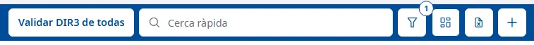
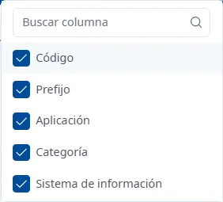

### Trucos de la interfaz

#### Objetivo

Reunir las funciones que se repiten en todas las pantallas de INVAI y ayudan a trabajar más rápido:
la búsqueda, los filtros y las columnas de las listas, los formularios, los desplegables y los
atajos de teclado.

#### Cómo se accede

Estos trucos sirven en todas las listas, fichas y ventanas de INVAI. Cada pantalla tiene su tema con
el detalle de sus campos y acciones.

#### Barra de las listas

- **Búsqueda rápida** (el cuadro de la lupa): busca mientras escribe, sin pulsar <kbd>Intro</kbd>,
  y vuelve a la primera página. La cruz del cuadro la borra.
- **Filtros** (el botón del embudo): abre y cierra el **Buscador**, debajo de la barra.
- **Mostrar / ocultar columnas**: elige las columnas que se ven.
- **Exportar Excel (.xls)**: solo en la lista de aplicaciones; todavía no está implementado y solo
  muestra un aviso.
- **Añadir** (el botón **+**): abre el alta de un registro nuevo.

Al pasar el ratón por estos botones verá su nombre.

#### Filtros

1. Haga clic en el botón del embudo para abrir el **Buscador**.
2. Rellene los filtros que quiera y haga clic en **Buscar**. Pulsar <kbd>Intro</kbd> en un filtro no
   busca.
3. **Limpiar** devuelve los filtros a sus valores iniciales y vuelve a buscar.

El número que aparece sobre el embudo indica cuántos filtros se aplicaron en la última búsqueda. En
la lista de aplicaciones aparece un **1** desde el principio, porque **Estado** muestra solo las
activas.

#### Columnas

Haga clic en **Mostrar / ocultar columnas** y marque las columnas que quiera ver. El cuadro
**Buscar columna** las filtra por el nombre. La elección no se guarda: cuando vuelva a entrar, la
lista aparecerá con las columnas de siempre.

#### Tablas

- **Ordenar**: haga clic en el título de una columna con flechas; otro clic invierte el orden. Solo
  se ordena por una columna a la vez. Con el teclado, llegue al título con <kbd>Tab</kbd> y pulse
  <kbd>Intro</kbd> o <kbd>Espacio</kbd>.
- **Abrir un registro**: haga doble clic en la fila, o sitúese en ella con <kbd>Tab</kbd> y pulse
  <kbd>Intro</kbd>.
- **Acciones de un registro**: los tres puntos del final de la fila abren el menú del registro, por
  ejemplo **Consultar** y **Editar**.
- **Páginas**: debajo de la tabla, cuántos registros se muestran (por ejemplo «Mostrando 1 a 10 de
  25 registros»), los botones para cambiar de página y cuántas filas se ven por página: 10, 20, 50
  o 100. Por defecto, 10.

Si una búsqueda no encuentra nada, la tabla dice «No se han encontrado resultados».

#### Formularios

- Los campos opcionales llevan «(opcional)» en el nombre; todos los demás son obligatorios. Algunas
  ventanas lo recuerdan con «Todos los campos son obligatorios, excepto los indicados como
  opcionales.».
- Si un campo obligatorio queda vacío o tiene un valor incorrecto, el mensaje aparece en rojo debajo
  del campo al salir de él, y todos a la vez al intentar guardar.
- En la ficha de una aplicación, cada pestaña se abre en consulta. **Editar** la pone en edición,
  **Guardar** guarda los cambios de la pestaña y **Cancelar** los deshace. Al guardar, aparece el
  aviso «Cambios guardados».
- Puede cambiar de pestaña sin perder lo que ha editado. Si quiere salir de la aplicación con
  cambios sin guardar, el aviso **Cambios sin guardar** dice qué pestañas debe guardar o cancelar
  antes; **Entendido** lo cierra.
- Si cierra una ventana de mantenimiento con cambios sin guardar, le pregunta si los quiere
  **Descartar** o **Guardar**.

#### Desplegables y fechas

- Los desplegables con muchos valores tienen un cuadro para buscar en ellos: escriba parte del
  nombre. En los filtros, la cruz del desplegable lo vacía.
- Las fechas se escriben como dd/mm/aaaa o se eligen en el calendario, que empieza la semana en
  lunes.

#### Avisos

- Los avisos de confirmación («Cambios guardados», «Aplicación dada de baja»…) aparecen arriba a la
  derecha y desaparecen solos a los pocos segundos; la cruz los cierra antes.
- Los errores que devuelve el servidor aparecen en una ventana con el botón **Cerrar**.

#### Atajos de teclado

- <kbd>Ctrl</kbd> + <kbd>K</kbd> (<kbd>Cmd</kbd> + <kbd>K</kbd> en un Mac): abre y cierra la ayuda
  desde cualquier lugar. Vea [Cómo usar la ayuda](using-help.md).
- <kbd>Esc</kbd>: cierra el desplegable o la ventana abierta, primero el desplegable.
- <kbd>Intro</kbd>: abre la fila de la tabla en la que está, u ordena por la columna en la que está.
- <kbd>Tab</kbd> y <kbd>Mayús</kbd> + <kbd>Tab</kbd>: pasan al control siguiente o al anterior.
- Flechas: recorren las opciones de los desplegables, de los menús de las filas y del menú lateral.
