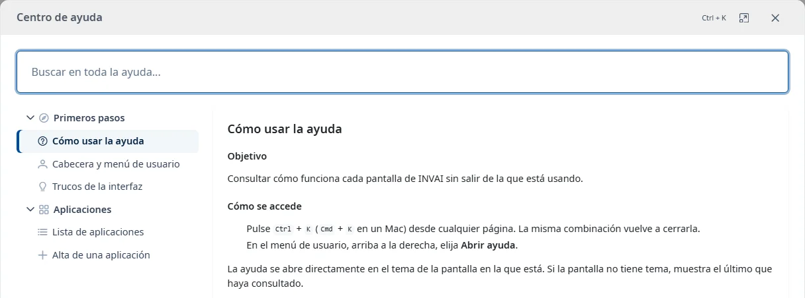
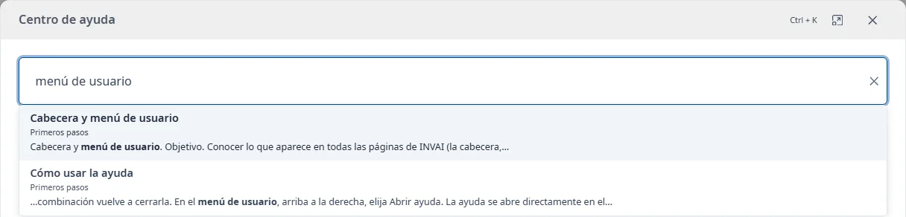

### Cómo usar la ayuda

#### Objetivo

Consultar cómo funciona cada pantalla de INVAI sin salir de la que está usando.

#### Cómo se accede

- Pulse <kbd>Ctrl</kbd> + <kbd>K</kbd> (<kbd>Cmd</kbd> + <kbd>K</kbd> en un Mac) desde cualquier
  página. La misma combinación vuelve a cerrarla.
- En el menú de usuario, arriba a la derecha, elija **Abrir ayuda**.
- En las pantallas y ventanas con ayuda disponible, pulse el botón **Abrir ayuda** (icono de
  interrogación) de la cabecera. Abre el tema de la pantalla, la pestaña o el formulario.

La ayuda se abre directamente en el tema de la pantalla en la que está. Si la pantalla no tiene
tema, muestra el último que haya consultado.

#### Buscar

El buscador de arriba (**Buscar en toda la ayuda...**) busca en el texto de todos los temas, no solo
en los títulos, a partir de dos letras:

- No distingue mayúsculas ni acentos: «aplicacion» encuentra «Aplicación».
- Con varias palabras, muestra los temas que las tienen todas, aunque no estén juntas.
- Primero aparecen los temas que tienen las palabras en el título y después los que más las
  repiten.

Cada resultado muestra el título del tema, el área en la que está y un fragmento con la palabra en
negrita. Pulse <kbd>Intro</kbd> para abrir el primero, o elija otro con las flechas o el ratón. La
primera vez que pulsa <kbd>Esc</kbd> se cierran los resultados; la segunda, la ayuda.

#### Índice

A la izquierda (arriba en pantallas pequeñas) están todos los temas, agrupados por áreas. El tema
abierto aparece marcado.

La lista de temas y el contenido se desplazan por separado. El buscador permanece visible arriba.

- Haga clic en un tema para abrirlo.
- Cada vez que abre la ayuda, solo se despliega la rama del tema activo. Haga clic en el nombre
  de un área para desplegarla o plegarla.
- Con el teclado, <kbd>Tab</kbd> recorre la lista e <kbd>Intro</kbd> o <kbd>Espacio</kbd> abren el
  tema o pliegan el área.

Al abrir un tema, el foco va a su título, y <kbd>Tab</kbd> continúa dentro del tema.

#### Enlaces

Los enlaces a otros temas los abren dentro del mismo centro de ayuda. Los enlaces a otras webs se
abren en una pestaña nueva.

#### Tamaño de la ventana

El botón de maximizar, junto al de cerrar, hace que la ayuda ocupe toda la pantalla. Vuelva a hacer
clic en él para recuperar el tamaño anterior.

#### Tenga en cuenta

- Para cerrar la ayuda, pulse <kbd>Esc</kbd>, haga clic en el botón de cerrar o fuera de la
  ventana, o vuelva a pulsar <kbd>Ctrl</kbd> + <kbd>K</kbd>. Volverá al lugar donde estaba.
- Si la ayuda no se puede cargar, verá un aviso con el botón **Reintentar**.
- El resto de opciones del menú de usuario están en
  [Cabecera y menú de usuario](header-and-user-menu.md).
