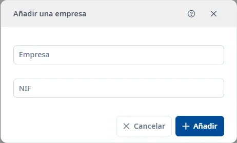

### Empresas

#### Objetivo

Consultar y mantener los registros de **Empresas**.

#### Cómo se accede

**Mantenimientos** → **Responsables** → **Empresas**. [Cómo funciona Responsables](responsibles.md).

#### Acciones disponibles

- El botón **+** abre el alta.
- El embudo muestra u oculta los filtros.
- El selector de columnas cambia las columnas visibles.
- La cruz del buscador rápido limpia el texto.
- El menú de tres puntos de cada fila permite consultar, editar o dar de baja. La baja pide confirmación.
- Doble clic o <kbd>Intro</kbd> sobre una fila abre la consulta.
- El botón de ayuda del formulario y <kbd>Ctrl</kbd> + <kbd>K</kbd> abren este tema.

#### Búsqueda y filtrado

La búsqueda rápida filtra la lista. Para combinar criterios, despliegue el embudo:

- **NIF**
- **Empresa**
- **Estado**

**Buscar** aplica los filtros; **Limpiar** los restablece. El estado inicial es **Activo**. También está la opción **Inactivo**.

#### Tabla de resultados

- **NIF**
- **Empresa**
- **Estado**

El estado se oculta en la consulta de activos. Utilice las cabeceras ordenables y los controles de paginación para recorrer los resultados.

#### Formulario

##### Añadir o editar

Obligatorios:

- **Empresa**: máximo 150 caracteres.

Opcionales:

- **NIF**: máximo 20 caracteres.

#### Guardar

**Añadir** crea el registro y **Guardar** aplica los cambios. Corrija los campos marcados si hay errores. **Cancelar** abandona la operación. Al cerrar una edición modificada, puede guardar o descartar los cambios.

#### Condiciones y permisos

Las operaciones pueden ser rechazadas si no tiene los permisos necesarios. En un registro inactivo puede utilizar la restauración. Dar de baja una empresa también da de baja sus personas y las asignaciones que tienen en aplicaciones. Lea la confirmación antes de continuar.
