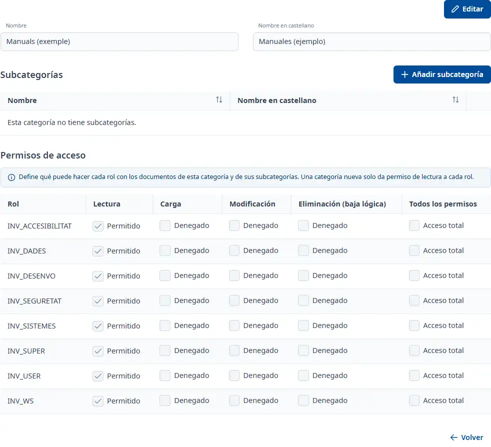

### Detalle de una categoría documental

#### Objetivo

Consultar y editar una categoría documental, sus subcategorías y los permisos de acceso de los roles.

#### Cómo se accede

**Mantenimientos** → **Documentación** → **Categorías documentales**. Abra una fila con doble clic, <kbd>Intro</kbd> o la consulta del menú. Vea [Documentación](documentation.md).

#### Acciones disponibles

- **Editar**
- **Cancelar**
- **Añadir subcategoría**
- **Guardar**
- **Volver**

La edición activa los nombres y los permisos. Cancelar recupera los valores guardados. Volver retorna a la lista; si hay cambios sin guardar, puede continuar editando o salir descartándolos.

#### Tabla de resultados

**Subcategorías**:

- **Nombre**
- **Nombre en castellano**

El menú de cada fila permite consultar, editar, dar de baja o restaurar según el estado. Las subcategorías se guardan con su propio formulario.

**Permisos de acceso**:

- **Rol**
- **Lectura**
- **Carga**
- **Modificación**
- **Eliminación (baja lógica)**
- **Todos los permisos**

Cada fila corresponde a un rol. La última casilla activa o desactiva todos los permisos de la fila. Los permisos se aplican a los documentos de la categoría y de sus subcategorías. Una categoría nueva solo concede lectura a cada rol.

#### Formulario

##### Editar la categoría o una subcategoría

Obligatorios:

- **Nombre**
- **Nombre en castellano**

Ambos nombres admiten hasta 150 caracteres. Al crear una subcategoría, la categoría queda fijada a la ficha actual. Al editarla, puede elegir otra categoría activa para moverla.

#### Guardar

Pulse **Guardar** para guardar los nombres y permisos de la categoría. Los cambios de subcategorías se confirman en su formulario y actualizan la tabla.

#### Condiciones y permisos

Una categoría inactiva solo se puede consultar: restáurela desde la lista antes de modificarla. Los permisos solo se consultan y modifican en categorías activas.
