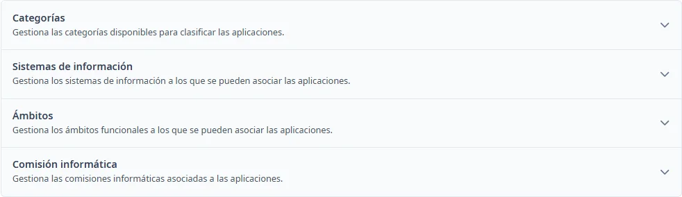

### Cómo funciona General

#### Objetivo

Gestionar los catálogos compartidos que se utilizan en las aplicaciones.

#### Cómo se accede

Abra **Mantenimientos** → **General**.

#### Apartados

- [Categorías](categories.md)
- [Sistemas de información](system-types.md)
- [Ámbitos](fields.md)
- [Comisión informática](commissions.md)

#### Acciones disponibles

Pulse el título de un apartado para desplegarlo o plegarlo. Con el teclado, llegue al título con <kbd>Tab</kbd> y actívelo con <kbd>Intro</kbd> o <kbd>Espacio</kbd>.

Desde esta pantalla, <kbd>Ctrl</kbd> + <kbd>K</kbd> abre este tema. Dentro de un formulario de catálogo, abre la ayuda del catálogo.
