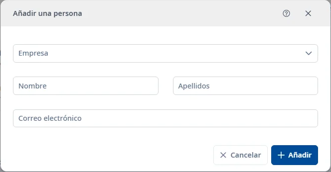

### Personal externo

#### Objetivo

Consultar y mantener los registros de **Personal externo**.

#### Cómo se accede

**Mantenimientos** → **Responsables** → **Personal externo**. [Cómo funciona Responsables](responsibles.md).

#### Acciones disponibles

- El botón **+** abre el alta.
- El embudo muestra u oculta los filtros.
- El selector de columnas cambia las columnas visibles.
- La cruz del buscador rápido limpia el texto.
- El menú de tres puntos de cada fila permite consultar, editar o dar de baja. La baja pide confirmación.
- Doble clic o <kbd>Intro</kbd> sobre una fila abre la consulta.
- El botón de ayuda del formulario y <kbd>Ctrl</kbd> + <kbd>K</kbd> abren este tema.

#### Búsqueda y filtrado

La búsqueda rápida filtra la lista. Para combinar criterios, despliegue el embudo:

- **Empresa**
- **Nombre**
- **Apellidos**
- **Correo electrónico**
- **Origen**
- **Estado**

**Buscar** aplica los filtros; **Limpiar** los restablece. El estado inicial es **Activo**. También está la opción **Inactivo**.

**Origen**: **Personas externas** / **Personal CAIB**.

#### Tabla de resultados

- **Empresa**
- **Nombre**
- **Apellidos**
- **Correo electrónico**
- **Estado**

El estado se oculta en la consulta de activos. Utilice las cabeceras ordenables y los controles de paginación para recorrer los resultados.

#### Formulario

##### Añadir o editar

Obligatorios:

- **Empresa**.
- **Nombre**: máximo 150 caracteres.
- **Apellidos**: máximo 150 caracteres.
- **Correo electrónico**: máximo 150 caracteres.

Elija una empresa activa e introduzca una dirección de correo válida.

#### Guardar

**Añadir** crea el registro y **Guardar** aplica los cambios. Corrija los campos marcados si hay errores. **Cancelar** abandona la operación. Al cerrar una edición modificada, puede guardar o descartar los cambios.

#### Condiciones y permisos

Las operaciones pueden ser rechazadas si no tiene los permisos necesarios. En un registro inactivo puede utilizar la restauración. Se necesita permiso de modificación de responsables. Sin empresas activas no se puede añadir una persona. El personal CAIB es de consulta. Una persona con empresa inactiva no se puede restaurar. Antes de dar de baja se comprueban las asignaciones; si las hay, puede transferirlas desde la confirmación. [Transferencia y revocación de roles](role-transfer.md).
