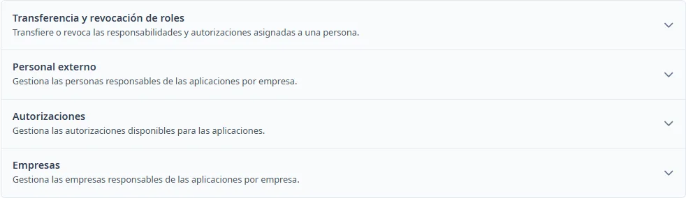

### Cómo funciona Responsables

#### Objetivo

Gestionar los catálogos compartidos que se utilizan en las aplicaciones.

#### Cómo se accede

Abra **Mantenimientos** → **Responsables**.

#### Apartados

- [Transferencia y revocación de roles](role-transfer.md)
- [Personal externo](people.md)
- [Autorizaciones](authorizations.md)
- [Empresas](companies.md)

#### Acciones disponibles

Pulse el título de un apartado para desplegarlo o plegarlo. Con el teclado, llegue al título con <kbd>Tab</kbd> y actívelo con <kbd>Intro</kbd> o <kbd>Espacio</kbd>.

Desde esta pantalla, <kbd>Ctrl</kbd> + <kbd>K</kbd> abre este tema. Dentro de un formulario de catálogo, abre la ayuda del catálogo.

#### Condiciones y permisos

La transferencia y revocación requiere el perfil INV_SUPER. Personal externo solo aparece con permiso de modificación de responsables. Autorizaciones y Empresas se pueden consultar desde esta pantalla.
