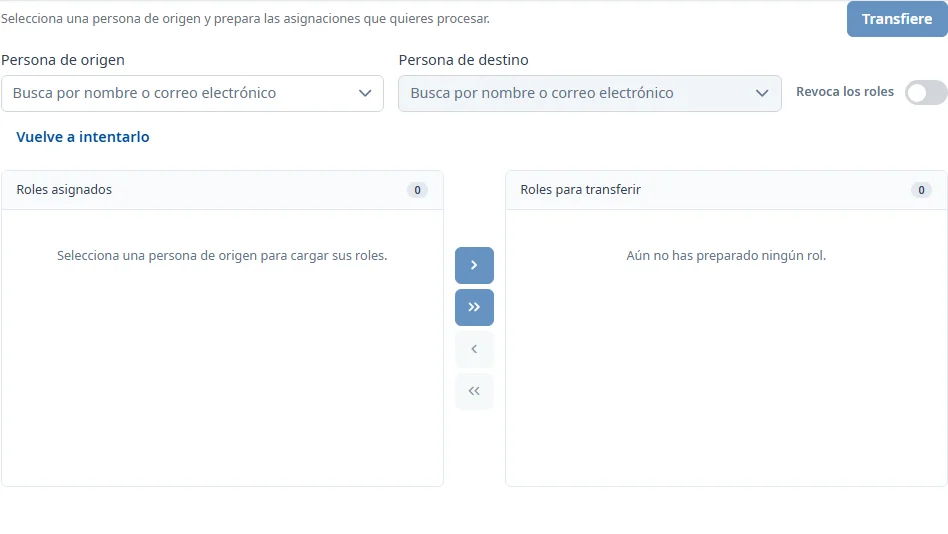

### Transferencia y revocación de roles

#### Objetivo

Transferir responsabilidades y autorizaciones entre personas, o revocar las asignaciones seleccionadas.

#### Cómo se accede

**Mantenimientos** → **Responsables** → **Transferencia y revocación de roles**. [Cómo funciona Responsables](responsibles.md).

#### Acciones disponibles

Las flechas permiten mover los roles seleccionados o todos los roles al lote y devolverlos al origen. También puede mover una aplicación entera o un grupo de responsabilidades o autorizaciones. Preparar el lote todavía no modifica las asignaciones.

#### Búsqueda y filtrado

Escriba al menos tres caracteres en los buscadores de personas o abra el desplegable para ver los primeros resultados. Seleccione una opción: escribir el nombre no es suficiente. El origen debe ser una persona ya registrada; el destino también puede proceder del directorio corporativo.

#### Formulario

##### Preparar una transferencia

Obligatorios:

- **Persona de origen**
- **Persona de destino**

Seleccione las asignaciones de la lista de origen y muévalas al lote. El destino debe ser diferente del origen. Espere a que se carguen sus asignaciones.

##### Preparar una revocación

Active **Revoca los roles**. Solo se necesita el origen y un lote con asignaciones; no se necesita destino.

#### Guardar

Pulse **Transfiere** o **Revoca**. Revise el número de roles y las personas en la confirmación antes de aceptar. La revocación da de baja las asignaciones y borra sus observaciones. Si cambia o limpia el origen con un lote preparado, se pide confirmar que se descarta el lote.

#### Condiciones y permisos

Si el destino ya tiene una autorización en una aplicación, no puede mover otra autorización de esa aplicación. Las asignaciones incompatibles que ya estaban en el lote vuelven al origen cuando se carga el destino.

Requiere INV_SUPER. El botón final solo se activa con un origen válido, un lote no vacío y, para transferir, un destino válido con los datos cargados. Si falla una carga, utilice el botón para volver a intentarlo antes de continuar.
