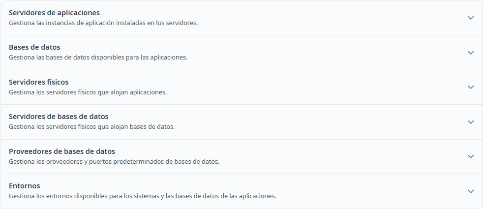
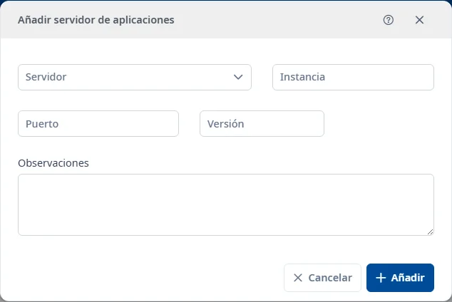
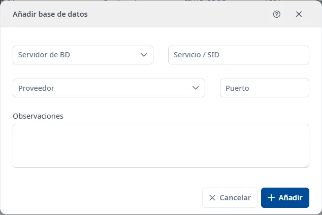
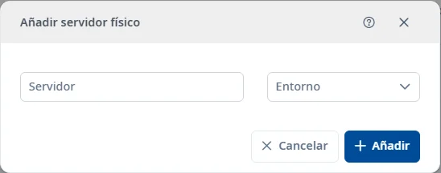
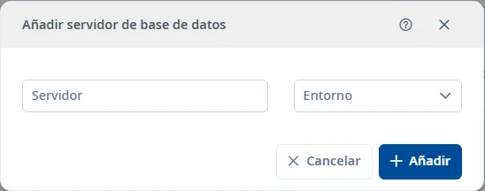
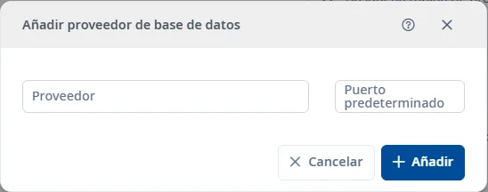
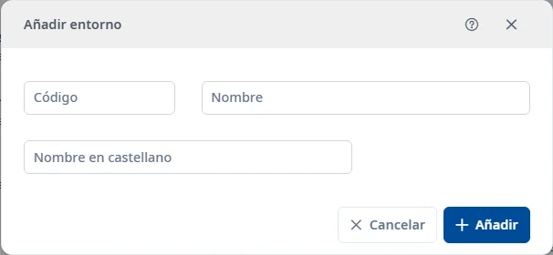

### Sistemas y BD

#### Objetivo

Mantener los servidores de aplicaciones, las bases de datos, los servidores físicos que los alojan, los proveedores de bases de datos y los entornos. Estos registros se pueden seleccionar en las relaciones de infraestructura de las aplicaciones.

#### Cómo se accede

Abra **Mantenimientos** → **Sistemas y BD**. Pulse el título de un apartado para desplegarlo; con el teclado, utilice <kbd>Tab</kbd> e <kbd>Intro</kbd>.

#### Acciones disponibles

- **+** abre el alta del catálogo desplegado.
- El embudo muestra u oculta los filtros.
- El selector de columnas permite elegir las columnas visibles.
- La cruz de la búsqueda rápida limpia el texto.
- El menú de tres puntos de una fila permite consultar, editar o dar de baja; la baja pide confirmación.
- Doble clic o <kbd>Intro</kbd> sobre una fila abre la consulta.
- En un registro inactivo, la restauración permite recuperarlo.
- El botón de ayuda del formulario y <kbd>Ctrl</kbd> + <kbd>K</kbd> abren este tema.

#### Búsqueda y filtrado

La búsqueda rápida filtra los registros. Para combinar criterios, abra el embudo y pulse **Buscar**. **Limpiar** restablece los filtros. **Estado** parte de **Activo**; puede seleccionar **Inactivo** o limpiarlo para consultar todos los estados.

##### Servidores de aplicaciones

- **Servidor**
- **Instancia**
- **Versión**
- **Estado**

##### Bases de datos

- **Servidor de BD**
- **Servicio / SID**
- **Proveedor**
- **Estado**

##### Servidores físicos

- **Servidor**
- **Entorno**
- **Estado**

##### Servidores de bases de datos

- **Servidor**
- **Entorno**
- **Estado**

##### Proveedores de bases de datos

- **Proveedor**
- **Puerto predeterminado**
- **Estado**

##### Entornos

- **Código**
- **Nombre**
- **Nombre en castellano**
- **Estado**

#### Tabla de resultados

Las cabeceras ordenables cambian el orden; los controles de paginación permiten recorrer la lista. Las columnas disponibles son:

##### Servidores de aplicaciones

- **Servidor**
- **Entorno**
- **Instancia**
- **Puerto**
- **Versión**
- **Observaciones**
- **Estado**

##### Bases de datos

- **Servidor de BD**
- **Entorno**
- **Servicio / SID**
- **Puerto**
- **Proveedor**
- **Observaciones**
- **Estado**

##### Servidores físicos

- **Servidor**
- **Entorno**
- **Estado**

##### Servidores de bases de datos

- **Servidor**
- **Entorno**
- **Estado**

##### Proveedores de bases de datos

- **Proveedor**
- **Puerto predeterminado**
- **Estado**

##### Entornos

- **Código**
- **Nombre**
- **Nombre en castellano**
- **Estado**

La columna de estado se muestra por defecto cuando consulta todos los estados y se oculta cuando aplica uno.

#### Formulario

En consulta, los datos se pueden leer. Para modificarlos, active **Editar**.

##### Servidores de aplicaciones

Obligatorios:

- **Servidor**.
- **Instancia**: máximo 50 caracteres.
- **Puerto**: del 1 al 65535.
- **Versión**: máximo 20 caracteres.

Opcionales:

- **Observaciones**

##### Bases de datos

Obligatorios:

- **Servidor de BD**.
- **Servicio / SID**: máximo 255 caracteres.
- **Puerto**: del 1 al 65535.
- **Proveedor**.

Opcionales:

- **Observaciones**

Al seleccionar un proveedor, el puerto se completa con su puerto por defecto; revíselo antes de guardar.

##### Servidores físicos

Obligatorios:

- **Servidor**: máximo 255 caracteres.
- **Entorno**.

##### Servidores de bases de datos

Obligatorios:

- **Servidor**: máximo 255 caracteres.
- **Entorno**.

##### Proveedores de bases de datos

Obligatorios:

- **Proveedor**: máximo 100 caracteres.
- **Puerto predeterminado**: del 1 al 65535.

##### Entornos

Obligatorios:

- **Código**: máximo 50 caracteres.
- **Nombre**: máximo 100 caracteres.
- **Nombre en castellano**: máximo 100 caracteres.

#### Guardar

**Añadir** crea el registro; **Guardar** guarda una edición. Corrija los campos señalados si hay errores. En consulta, **Aceptar** cierra el formulario. **Cancelar** abandona el alta o recupera la consulta al cancelar una edición. Si cierra una edición modificada, puede guardar o descartar los cambios.

#### Condiciones y permisos

Los puertos deben ser números enteros. Las observaciones tienen un límite de 4000 bytes de texto; los caracteres especiales pueden ocupar más de un byte y el formulario avisa si lo supera.

Las operaciones dependen de los permisos de la sesión y del estado del registro. Las opciones de los desplegables proceden de los catálogos; si falta una opción necesaria, revise su mantenimiento. Un error al guardar no confirma la operación: revise el mensaje y vuelva a intentarlo cuando se haya resuelto.
